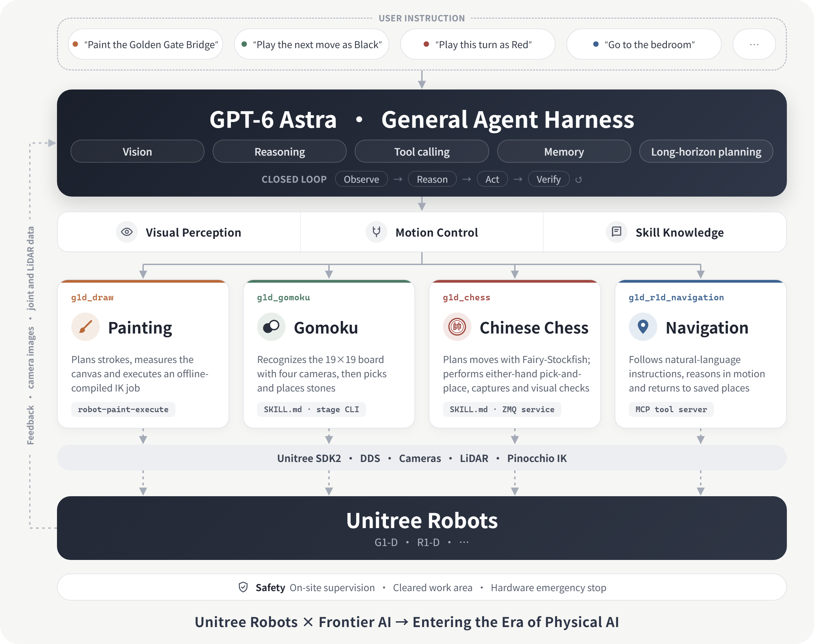

<div align="center">
  <h1 align="center">Unitree RobotSkills</h1>
  <a href="https://www.unitree.com/" target="_blank">
    
  </a>
  <p align="center"><b>Unitree Robots · GPT‑6 Astra · General Skills for the Physical World</b></p>
  <p align="center">
    <a>English</a> | <a href="README.zh.md">中文</a>
  </p>
  <p align="center">
    
    
    
  </p>
</div>

**Unitree RobotSkills** combines Unitree robots with frontier AI (GPT‑6 Astra, Claude Opus and others) to build agents that can read images, reason and call tools. Once given a set of robot skills, an AI model observes the scene through the robot's cameras, makes decisions autonomously and carries out tasks in the physical world. No dedicated model needs to be trained for each skill, which is a first step towards controlling robots through language instructions alone.

> **Unitree Robots × Frontier AI → Entering the Era of Physical AI**: one general AI agent empowers multiple Unitree robots, turning intelligence in conversation into action in the physical world.

## 📺 Video Demo

<table>
  <tr>
    <td align="center" width="25%">
      <a href="assets/demo_draw.mp4"></a>
      <p><b>Painting</b><br>G1-D</p>
    </td>
    <td align="center" width="25%">
      <a href="assets/demo_gomoku.mp4"></a>
      <p><b>Gomoku</b><br>G1-D</p>
    </td>
    <td align="center" width="25%">
      <a href="assets/demo_chess.mp4"></a>
      <p><b>Chinese Chess</b><br>G1-D</p>
    </td>
    <td align="center" width="25%">
      <a href="assets/demo_navigation.mp4"></a>
      <p><b>Navigation</b><br>R1-D</p>
    </td>
  </tr>
</table>

Click a preview to watch the full video. The demos are sped up, and part of the waiting time for model reasoning and network requests has been trimmed.

## 0. 📖 Introduction

### 1. Why It Matters

Robot skills are usually built one task at a time: a dedicated perception model, a hand-written state machine and a fixed motion script. RobotSkills takes a different approach: **the GPT‑6 Astra general agent serves as the brain for every task**, and each skill provides the agent only with the capabilities the task requires:

- **Visual perception**: raw camera frames from the robot, read and interpreted directly by the agent.
- **Motion control**: bounded robot tools built on Unitree SDK2 / DDS (arm poses, gripper, base motion, return to home).
- **Skill knowledge**: a `SKILL.md` or tool description that tells the agent how to perform the task, what to check and when to stop.

The agent closes the loop autonomously: observe → reason → act → verify. A new task only requires a new skill, not a new model; supporting a new robot only requires adding its tools.

<p align="center">
  
</p>

### 2. Skills

| Skill | Robot | What the agent does | Interface |
| --- | --- | --- | --- |
| [g1d_draw](unitree_gpt6/g1d_draw/README.md) | G1-D | Plans strokes, measures the paper and material points, compiles trajectories offline, then paints through the SDK | `robot-paint-execute` workflow |
| [g1d_gomoku](unitree_gpt6/g1d_gomoku/README.md) | G1-D | Recognizes the 19×19 board from four cameras, selects a move, picks and places the stone with the right arm and returns to home; asks for user confirmation before releasing the gripper | [SKILL.md](unitree_gpt6/g1d_gomoku/SKILL.md), autonomous-round CLI |
| [g1d_chess](unitree_gpt6/g1d_chess/README.md) | G1-D | Recognizes the Chinese chess board, plans the move for the current round with Fairy-Stockfish, picks and places with either hand, handles captures and reviews the result | [SKILL.md](unitree_gpt6/g1d_chess/SKILL.md), service and single-round scripts |
| [g1d_r1d_navigation](unitree_gpt6/g1d_r1d_navigation/README.md) | R1-D / G1-D | Navigates autonomously from natural-language instructions through MCP tools: observes, moves, keeps reasoning while in motion, and records and returns to places | MCP tool server; plus a deterministic preview CLI |

### 3. 🗺️ Repository Layout

```text
unitree_robotskills/
├── README.md / README.zh.md / LICENSE
├── pyproject.toml               # all skill dependencies (extras) and packaging
├── assets/                      # demo videos, previews and architecture diagrams
├── docs/
│   ├── architecture.md          # interface conventions and lifecycle
│   └── safety.md                # safety requirements before running on a real robot
└── unitree_gpt6/
    ├── g1d_draw/                # painting: planning, measurement, compilation and SDK execution
    ├── g1d_gomoku/              # Gomoku: autonomous rounds and hardware tools
    │   └── models/              # G1 model resources and licenses used by Gomoku
    ├── g1d_chess/               # Chinese chess: service, scripts and board annotation tools
    └── g1d_r1d_navigation/      # navigation: MCP runtime and preview skeleton
        └── common/              # preview input/output, configuration and CLI
```

### 4. ⚠️ Safety

**These skills can drive a real robot. Check carefully before actual operation to ensure safety.**

- Every physical skill requires matching hardware and SDK versions, validated coordinates and units, current calibration, a cleared area, on-site personnel and an accessible hardware emergency stop.
- A software stop does not replace the hardware emergency stop. If the robot behaves dangerously, follow the on-site emergency stop and isolation procedure first, then collect logs with personal and site information removed.
- Do not reproduce safety issues on an unsupervised real robot. Report security issues privately to the maintainers, without public exploit details or credentials.

Read [docs/safety.md](docs/safety.md) and the limitations in each skill's documentation before connecting to hardware.

### 5. 🙏 Acknowledgements

This project builds on the following open-source projects. Please visit each project's page for its license:

1. [unitree_sdk2_python](https://github.com/unitreerobotics/unitree_sdk2_python): DDS communication with Unitree robots (bundled with the Gomoku skill under BSD 3-Clause)
2. [xr_teleoperate](https://github.com/unitreerobotics/xr_teleoperate): teleoperation and image service for Unitree robots
3. [unitree_ros](https://github.com/unitreerobotics/unitree_ros): G1 robot description
4. [Pinocchio](https://github.com/stack-of-tasks/pinocchio) and [CasADi](https://github.com/casadi/casadi): kinematics and inverse kinematics
5. [Fairy-Stockfish](https://github.com/fairy-stockfish/Fairy-Stockfish): Chinese chess engine (installed separately)
6. [DeepSeek-Harness](https://github.com/deepseek-ai/deepseek-harness) and the [Model Context Protocol](https://modelcontextprotocol.io): agent host and tool protocol for the navigation skill
7. [Cyclone DDS](https://github.com/eclipse-cyclonedds/cyclonedds), [OpenCV](https://github.com/opencv/opencv) and [pyzmq](https://github.com/zeromq/pyzmq)

### 6. 📝 License

This project is licensed under the [Apache License 2.0](LICENSE). Bundled third-party components keep their original licenses, stored next to the components (for example `unitree_gpt6/g1d_gomoku/models/g1/licenses/` and `unitree_gpt6/g1d_gomoku/src/unitree_sdk2py/LICENSE`). Third-party models, SDKs, assets and data are governed by their own licenses.

Our goal is to give AI agents the ability to act in the physical world, achieved step by step, one robot skill at a time.
