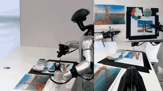
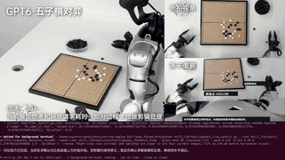
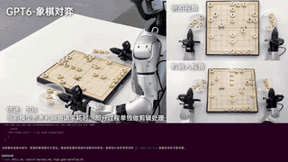
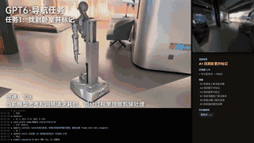
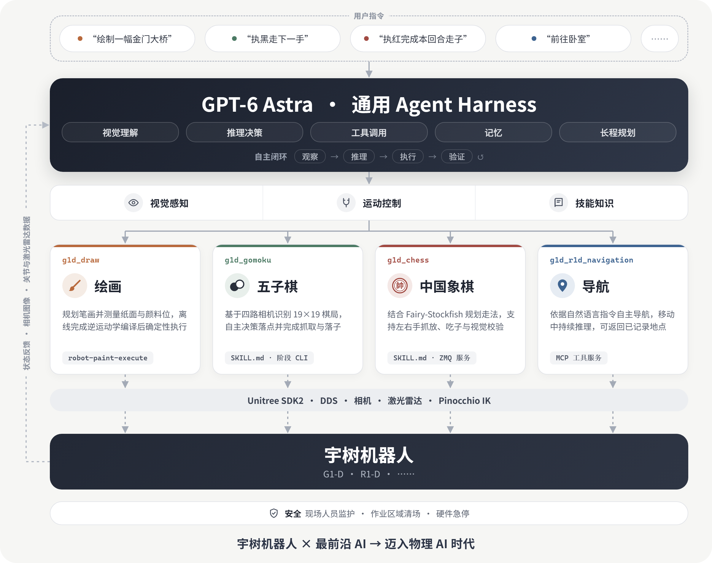

<div align="center">
  <h1 align="center">Unitree RobotSkills</h1>
  <a href="https://www.unitree.com/" target="_blank">
    
  </a>
  <p align="center"><b>宇树机器人 · GPT‑6 Astra · 物理世界通用技能</b></p>
  <p align="center">
    <a href="README.md">English</a> | <a>中文</a>
  </p>
  <p align="center">
    
    
    
  </p>
</div>

**Unitree RobotSkills** 将宇树机器人与最前沿的 AI（GPT‑6 Astra、Claude Opus 等）相结合，构建能够看图、推理并调用工具的 Agent。AI 模型获得一组机器人技能后，即可通过机器人相机观察现场、自主决策，并在物理世界中执行相应任务；无需为每个技能单独训练专用模型，初步实现仅凭语言指令即可控制机器人完成任务。

> **宇树机器人 × 最前沿 AI → 迈入物理 AI 时代**：一个通用 AI Agent 为多款宇树机器人赋能，把对话中的智能变成物理世界中的行动。

## 📺 视频演示

<table>
  <tr>
    <td align="center" width="25%">
      <a href="assets/demo_draw.mp4"></a>
      <p><b>绘画</b><br>G1-D</p>
    </td>
    <td align="center" width="25%">
      <a href="assets/demo_gomoku.mp4"></a>
      <p><b>五子棋</b><br>G1-D</p>
    </td>
    <td align="center" width="25%">
      <a href="assets/demo_chess.mp4"></a>
      <p><b>中国象棋</b><br>G1-D</p>
    </td>
    <td align="center" width="25%">
      <a href="assets/demo_navigation.mp4"></a>
      <p><b>导航</b><br>R1-D</p>
    </td>
  </tr>
</table>

点击预览图查看完整视频。演示视频有加速，并剪去了部分模型思考和网络请求的等待时间。

## 0. 📖 项目简介

### 1. 项目价值

机器人技能通常一次只解决一个任务：专用感知模型、手写状态机、固定动作脚本。RobotSkills 采用另一种方式：**由 GPT‑6 Astra 通用 Agent 担任所有任务的大脑**，每个技能仅向 Agent 提供完成任务所需的能力：

- **视觉感知**：机器人相机的原始画面，由 Agent 直接读取并理解。
- **运动控制**：基于 Unitree SDK2 / DDS、带边界约束的机器人工具（手臂位姿、夹爪、底盘运动、归位）。
- **技能知识**：`SKILL.md` 或工具说明，告诉 Agent 任务如何执行、需要检查什么、何时停止。

Agent 自主完成闭环：观察 → 推理 → 执行 → 验证。新增任务只需编写新技能，无需训练新模型；支持新机器人只需补充相应的工具。

<p align="center">
  

</p>


### 2. 技能列表

| 技能 | 机器人 | Agent 完成的工作 | 接口 |
| --- | --- | --- | --- |
| [g1d_draw](unitree_gpt6/g1d_draw/README.zh.md) | G1-D | 规划笔画、测量纸面与材料点、离线编译轨迹，再通过 SDK 执行绘制 | [SKILL.zh.md](unitree_gpt6/g1d_draw/SKILL.zh.md) |
| [g1d_gomoku](unitree_gpt6/g1d_gomoku/README.zh.md) | G1-D | 通过四路相机识别 19×19 棋局，自主选点，右臂抓放棋子并归位；松爪前征得用户确认 | [SKILL.zh.md](unitree_gpt6/g1d_gomoku/SKILL.zh.md)、自主轮次 CLI |
| [g1d_chess](unitree_gpt6/g1d_chess/README.zh.md) | G1-D | 识别中国象棋棋局，调用 Fairy-Stockfish 规划本轮走法，左右手抓放、处理吃子并复盘结果 | [SKILL.zh.md](unitree_gpt6/g1d_chess/SKILL.zh.md)、服务与单轮脚本 |
| [g1d_r1d_navigation](unitree_gpt6/g1d_r1d_navigation/README.zh.md) | R1-D / G1-D | 依据自然语言指令，通过 MCP 工具自主导航：观察画面、移动、移动中持续推理，并可记录与返回地点 | MCP 工具服务；另有确定性预览 CLI |


### 3. 🗺️ 目录结构

```text
unitree_robotskills/
├── README.md / README.zh.md / LICENSE
├── pyproject.toml               # 全部技能依赖（extras）与打包配置
├── assets/                      # 演示视频、预览图与架构图
├── docs/
│   ├── architecture.md          # 接口约定与生命周期
│   └── safety.md                # 真机运行前的安全要求
└── unitree_gpt6/
    ├── g1d_draw/                # 绘画：规划、测量、编译与 SDK 执行
    ├── g1d_gomoku/              # 五子棋：自主轮次与硬件工具
    │   └── models/              # 五子棋使用的 G1 模型与许可
    ├── g1d_chess/               # 中国象棋：服务、脚本与棋盘标注工具
    └── g1d_r1d_navigation/      # 导航：MCP 运行时与预览骨架
        └── common/              # 预览输入输出、配置与 CLI
```


### 4. ⚠️ 安全

**这些技能可以驱动真实机器人，在实际运行前请仔细检查，确保安全。**

- 所有实体技能都需要匹配的硬件与 SDK 版本、经过验证的坐标与单位、当前标定、清空的场地、现场值守人员，以及触手可及的硬件急停。
- 软件停止不能替代硬件急停，设备出现危险时，先按现场急停与隔离流程处理，再收集去除个人和现场信息的日志。
- 不要在无人监护的真实机器人上复现安全问题。安全问题请私下报告给维护者，不要公开利用细节或密钥。

接入硬件前请阅读 [docs/safety.zh.md](docs/safety.zh.md) 和各技能文档中的限制说明。

### 5. 🙏 致谢

本项目基于以下开源项目，许可证请访问各项目页面查看：

1. [unitree_sdk2_python](https://github.com/unitreerobotics/unitree_sdk2_python)：宇树机器人 DDS 通信（以 BSD 3-Clause 随五子棋技能内置）
2. [xr_teleoperate](https://github.com/unitreerobotics/xr_teleoperate)：宇树机器人遥操作和图像服务
3. [unitree_ros](https://github.com/unitreerobotics/unitree_ros)：G1 机器人描述
4. [Pinocchio](https://github.com/stack-of-tasks/pinocchio) 与 [CasADi](https://github.com/casadi/casadi)：运动学与逆运动学
5. [Fairy-Stockfish](https://github.com/fairy-stockfish/Fairy-Stockfish)：中国象棋引擎（需单独安装）
6. [DeepSeek-Harness](https://github.com/deepseek-ai/deepseek-harness) 与 [Model Context Protocol](https://modelcontextprotocol.io)：导航技能的 Agent 宿主与工具协议
7. [Cyclone DDS](https://github.com/eclipse-cyclonedds/cyclonedds)、[OpenCV](https://github.com/opencv/opencv)、[pyzmq](https://github.com/zeromq/pyzmq)

### 6. 📝 许可证

本项目采用 [Apache License 2.0](LICENSE)。随包内置的第三方组件保留其原始许可证，存放在组件旁（如 `unitree_gpt6/g1d_gomoku/models/g1/licenses/` 与 `unitree_gpt6/g1d_gomoku/src/unitree_sdk2py/LICENSE`）。第三方模型、SDK、素材与数据遵守各自的许可。

我们的目标是让 AI Agent 具备在物理世界中行动的能力，并以机器人技能为单位逐步实现。
