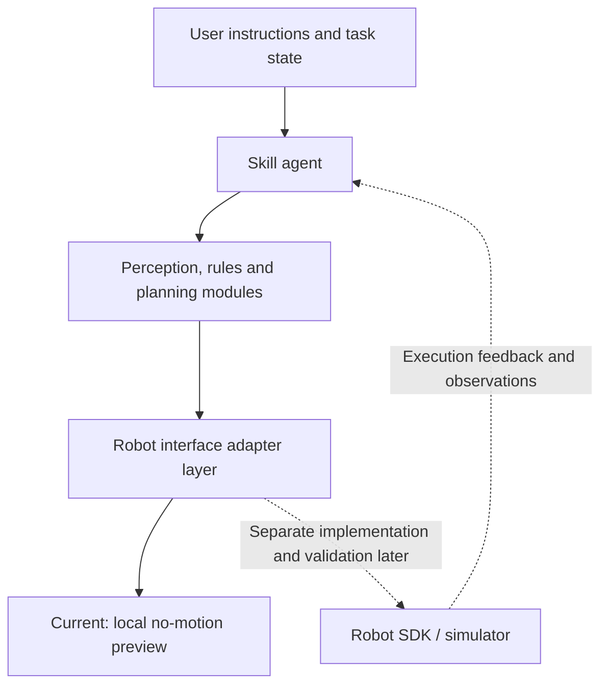

# Architecture and interface conventions

English | [中文](architecture.zh.md)

This document describes `g1d_r1d_navigation/common/` and the navigation preview skeleton, as well as the separate painting and Gomoku workflows. Chinese chess (Xiangqi) uses its own source code, configuration, models and scripts and does not plug into the navigation preview interface; for its model orchestration, full-plan preflight, service execution and checkpoint interfaces, see the [g1d_chess runtime guide](../unitree_gpt6/g1d_chess/docs/runtime.md).

## Layers



The repository root holds the project conventions, documentation and development tools; `unitree_gpt6/` organizes the skills under model and agent integration. The name does not claim that any model API is available. `g1d_r1d_navigation/common/` is used only by the navigation preview and provides input/output, configuration and the preview flow; robot-specific logic stays inside each skill.

The unified preview entry point has no model provider or shared tool-calling framework (the real-robot runtime of `g1d_r1d_navigation` connects to a vision LLM through an MCP host; it is a separate implementation inside that skill, see its README). Future integrations should declare the actual model, SDK, interface and version in the configuration and use a dedicated client, so that no single service is coupled to a single robot. Currently `model_provider` only accepts `none`.

## Painting workflow

`unitree_gpt6/g1d_draw/src/` independently implements planning input, measurement records for the paper surface and material stations, IK compilation, job validation, script export and execution, and does not depend on `common.PreviewAgent`.

Reference image and stroke planning → on-site measurement → `measurements.json` / `strokes.json` → `prepare` → compiled job, preview and `run.sh` → G1/Dex1 execution.

`robot-paint-execute` and `python -m unitree_gpt6.g1d_draw.src.main` are the same entry point. `init-task` creates input templates, and `demo-workflow` demonstrates the complete flow offline with synthetic data. Hardware runs are handled by a separate backend covering DDS communication, real-time feedback, control authority, stopping and holding; compilation uses the device URDF and calibration results, and example coordinates cannot replace on-site measurement.

For installation and input formats, see the [painting README](../unitree_gpt6/g1d_draw/README.md).

## Navigation preview lifecycle

| Stage | Current preview behavior | Requirements for later real execution |
| --- | --- | --- |
| Initialize | Read configuration; check model declaration, mode, counts and time limits | Check actual model, connection, calibration, device state and stop mechanism |
| Understand | Match the few example inputs listed in the documentation | Model parses the goal, tool calls and context management |
| Plan | Generate a deterministic symbolic plan | Validate perception, rules, collisions and motion constraints |
| Execute | Generate local preview feedback without connecting to a device | Execute through a separate SDK adapter layer with timeout and cancellation support |
| Observe | Return `observation_available: false` | Sensor and execution state feedback |
| Verify | Return `task_verified: false` | Re-check the goal; decide on completion, retry or safe stop |

`limits.task_timeout_s` currently only checks local planning time; it is not a preemptible hardware watchdog. Do not swap the preview adapter directly for blocking hardware calls and assume timeout protection is in place.

## Implemented data structures

Definitions are in `unitree_gpt6/g1d_r1d_navigation/common/contracts.py` and are JSON-serializable.

```text
SkillInput
  user_instruction: str
  robot_state: dict       # reserved, not used by current examples
  environment_state: dict # reserved, not used by current examples
  skill_config: dict      # loaded and validated skill configuration

Action
  name: str
  parameters: dict       # the skill's own symbolic plan, not yet a robot control protocol

SkillOutput
  task_status: previewed | failed
  action_plan: list[Action]
  execution_feedback: dict
  error_info: {type, message} | null
```

The CLI currently only accepts the instruction, the configuration path and the execution mode. It builds a `SkillInput` and outputs JSON; `previewed` returns exit code 0, runtime or configuration failures return 1, and command-line usage errors return 2.

```json
{
  "task_status": "previewed",
  "action_plan": [{"name": "pen_up", "parameters": {}}],
  "execution_feedback": {
    "mode": "preview",
    "hardware_commands_sent": 0,
    "actions_previewed": 1,
    "observation_available": false,
    "task_verified": false
  },
  "error_info": null
}
```

This illustrates the output fields; the complete plan is generated by the specific skill. Before adding states such as `completed` or `cancelled` in the future, the state transitions, feedback meaning and tests must be defined at the same time.

## Module boundaries

- **Agent** coordinates the task and does not access motors or low-level navigation directly.
- **Planner / Engine** handles trajectories, game rules and goals; decisions are separated from physical operations.
- **Perception** provides state with coordinate frame, timestamp and confidence (future implementation).
- **Adapter** wraps the actual SDK, execution and stop semantics; the common skeleton provides `PreviewAdapter`, and painting uses a separate G1-D / Dex1 backend.
- **Tests** validate planning and failure boundaries and by default run fully without hardware or network.

Painting paper-surface paths and device-space positions are in meters, and joints and orientations in radians; the paper mapping, tool offset and material stations come from the task measurement records. Gomoku coordinate conventions are described in its autonomous round and configuration documents. Navigation preview targets use `map_unregistered`, with positions in meters and orientations in radians; example values cannot be used directly as real-robot coordinates.

## Gomoku autonomous rounds

```text
observing → awaiting_board_review → target_selected
          → awaiting_release_confirmation → releasing_and_returning → returned
```

`play` saves the four raw images; the host agent views the images and writes the recognition result; `decide` checks the turn and game end, then selects and annotates the point automatically. Fine pick-and-place adjustment is carried out by the host agent in a tool loop; `prepare-release` binds the selected point, the low-position check and the precomputed return path, and `release`, after user confirmation, executes in a single session and waits for the entire retreat. There is no user-specified landing point or symbolic preview interface.

Round data is stored in a separate run directory and does not use the shared SkillInput/SkillOutput. The CLI returns the stage status and the next step; failures return non-zero. `returned` is reported only when the measured return-home joints pass; the final landing point has no post-placement image acceptance, and the two are always recorded separately. `execution_failed` cannot be replayed automatically; an image observation failure also requires investigating the cause and creating a new round.

## Gomoku calibration and experience

The robot SDK ships with the project; for its source and license, see the [SDK notes](../unitree_gpt6/g1d_gomoku/src/unitree_sdk2py/VENDORED.md).
The project only publishes game rules, control settings, models, an empty experience template and data structures; it does not publish the dimensions, poses or return-home parameters of any particular deployment.
On first execution, the host agent establishes the scene calibration from the current images, feedback and models, and collects the current device's return-home reference read-only.
Only after a successful return home does the agent generate candidate experience, which is appended to the workspace after `src.experience` validates the deployment binding and evidence.
Source files stay read-only at runtime; experience cannot override control limits, pin move selection or replace real-time feedback.
For structure and lifecycle, see the [experience data conventions](../unitree_gpt6/g1d_gomoku/docs/experience.md).
