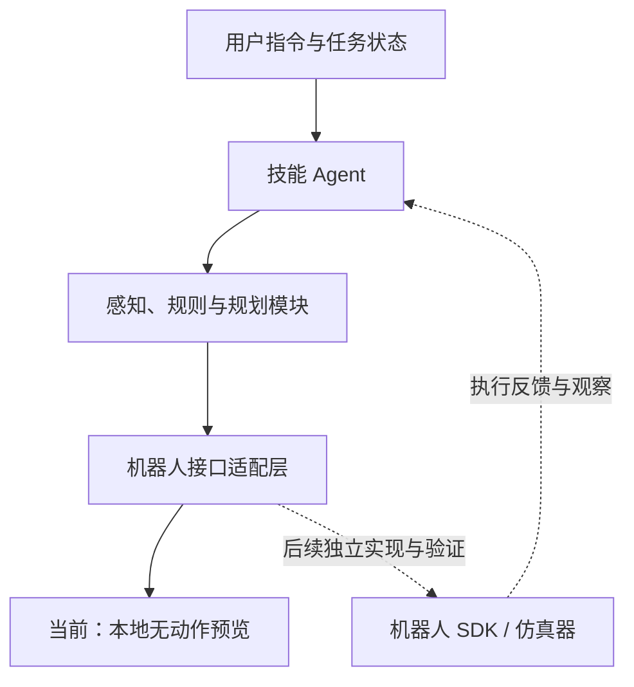

# 架构与接口约定

[English](architecture.md) | 中文

本文描述 `g1d_r1d_navigation/common/` 与导航预览骨架，以及独立的绘画和五子棋工作流。中国象棋独立使用其源码、配置、模型和脚本，不接入导航预览接口；其模型编排、完整计划预检、服务执行与检查点接口见 [g1d_chess 运行说明](../unitree_gpt6/g1d_chess/docs/runtime.zh.md)。

## 分层



根目录管理项目规范、文档与开发工具；`unitree_gpt6/` 组织模型与 Agent 集成下的技能。该名称不声明模型 API 可用性。`g1d_r1d_navigation/common/` 仅供导航预览使用，提供输入输出、配置和预览流程；机器人特殊逻辑留在各技能内部。

统一预览入口没有模型提供方或公共工具调用框架（`g1d_r1d_navigation` 的真机运行时经 MCP 宿主接入视觉大模型，是技能内部的独立实现，见其 README）。未来接入时应在配置中声明实际模型、SDK、接口与版本，设计独立客户端，避免将某一家服务和某一机器人耦合。当前 `model_provider` 只接受 `none`。

## 绘画工作流

`unitree_gpt6/g1d_draw/src/` 独立实现规划输入、纸面与材料站点测量记录、IK 编译、作业校验、脚本导出和执行，不依赖 `common.PreviewAgent`。

参考图与笔画规划 → 现场测量 → `measurements.json` / `strokes.json` → `prepare` → 编译作业、预览与 `run.sh` → G1/Dex1 执行。

`robot-paint-execute` 与 `python -m unitree_gpt6.g1d_draw.src.main` 是同一入口。`init-task` 创建输入模板，`demo-workflow` 用合成数据离线演示完整流程。硬件运行由独立后端处理 DDS 通信、实时反馈、控制权、停止和持有；编译使用设备 URDF 和标定结果，示例坐标不能代替现场测量。

安装与输入格式见 [绘画说明](../unitree_gpt6/g1d_draw/README.zh.md)。

## 导航预览生命周期

| 阶段 | 当前预览行为 | 后续真实执行要求 |
| --- | --- | --- |
| Initialize | 读取配置，检查型号声明、模式、数量和时间限制 | 实际型号、连接、标定、设备状态与停止机制检查 |
| Understand | 匹配少量文档列出的示例输入 | 模型解析目标、工具调用与上下文管理 |
| Plan | 生成确定性符号计划 | 感知、规则、碰撞与运动约束验证 |
| Execute | 生成本地预览反馈，不连接设备 | 通过独立 SDK 适配层执行，支持超时与取消 |
| Observe | 返回 `observation_available: false` | 传感器与执行状态反馈 |
| Verify | 返回 `task_verified: false` | 复核目标；决定完成、重试或安全停止 |

`limits.task_timeout_s` 当前仅检查本地规划耗时，不是可抢占的硬件看门狗。不得将预览适配器直接替换成阻塞的硬件调用并假设已获得超时保护。

## 已实现的数据结构

定义位于 `unitree_gpt6/g1d_r1d_navigation/common/contracts.py`，JSON 可序列化。

```text
SkillInput
  user_instruction: str
  robot_state: dict       # 预留，当前示例不使用
  environment_state: dict # 预留，当前示例不使用
  skill_config: dict      # 已加载并验证的技能配置

Action
  name: str
  parameters: dict       # 技能自己的符号计划，尚非机器人控制协议

SkillOutput
  task_status: previewed | failed
  action_plan: list[Action]
  execution_feedback: dict
  error_info: {type, message} | null
```

CLI 当前只接收指令、配置路径和执行模式。它构造 `SkillInput`，输出 JSON；`previewed` 返回退出码 0，运行或配置失败返回 1，命令行参数用法错误返回 2。

```json
{
  "task_status": "previewed",
  "action_plan": [{"name": "pen_up", "parameters": {}}],
  "execution_feedback": {
    "mode": "preview",
    "hardware_commands_sent": 0,
    "actions_previewed": 1,
    "observation_available": false,
    "task_verified": false
  },
  "error_info": null
}
```

这是输出字段示意；完整计划由具体技能生成。未来新增 `completed`、`cancelled` 等状态前，需要同时定义状态转移、反馈含义与测试。

## 模块边界

- **Agent** 协调任务，不直接访问电机或导航底层。
- **Planner / Engine** 处理轨迹、棋规和目标；决策与实体操作分离。
- **Perception** 提供带坐标系、时间戳与置信度的状态（未来实现）。
- **Adapter** 封装实际 SDK、执行与停止语义；公共骨架提供 `PreviewAdapter`，绘画使用独立的 G1-D / Dex1 后端。
- **Tests** 验证规划和失败边界，默认完全脱离硬件与网络。

绘画纸面路径和设备空间位置以米表示，关节与朝向以弧度表示；纸面映射、工具偏移和材料站点来自任务测量记录。五子棋坐标约定见其自主轮次与配置文档。导航预览目标使用 `map_unregistered`，位置单位为米，朝向为弧度；示例值不可直接作为真机坐标。

## Gomoku 自主轮次

```text
observing → awaiting_board_review → target_selected
          → awaiting_release_confirmation → releasing_and_returning → returned
```

`play` 保存四路原图；宿主 Agent 看图写识别结果；`decide` 检查回合和终局后自动选点、标注。抓放精调由宿主 Agent 执行工具闭环，`prepare-release` 绑定选点、低位核对和预计算返程，`release` 在用户确认后单会话执行并等待整个回撤。没有用户指定落点或符号预览接口。

轮次数据保存在独立运行目录，不使用共用的 SkillInput/SkillOutput。CLI 返回阶段状态和下一步；失败返回非零。`returned` 只在实测归位关节通过时报告，最终落点没有放子后图像验收，始终分开记录。`execution_failed` 不能自动重放；图像观察失败也需要查清原因并创建新轮次。

## Gomoku 的标定与经验

机器人 SDK 随工程提供，来源和许可证见 [SDK 说明](../unitree_gpt6/g1d_gomoku/src/unitree_sdk2py/VENDORED.md)。
工程只发布棋规、控制设置、模型、空经验模板和数据结构，不发布某次部署的尺寸、位姿或归位参数。
首次执行由宿主 Agent 根据当前图像、反馈和模型建立场景标定，并只读采集当前设备的归位参考。
成功归位后，Agent 才生成候选经验，通过 `src.experience` 校验部署绑定与证据后追加到工作空间。
源文件在运行时保持只读；经验不能覆盖控制限值、固定选点或替代实时反馈。
结构与生命周期见 [经验数据约定](../unitree_gpt6/g1d_gomoku/docs/experience.zh.md)。
