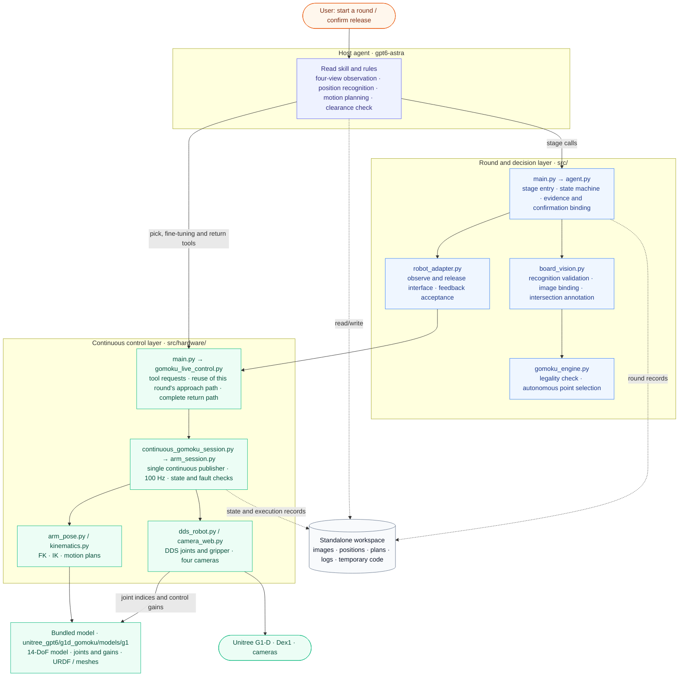
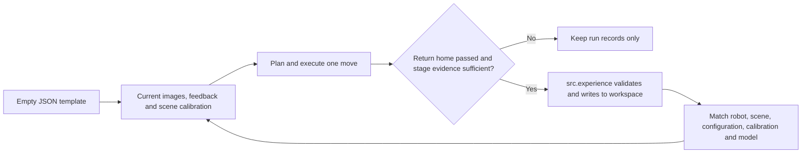

# G1-D autonomous Gomoku: code framework and runtime workspace

English | [中文](ARCHITECTURE.zh.md)

In this skill, **gpt6-astra looks at the images and plans, the game engine selects the point autonomously, and a continuous control process drives the robot**. When the user says "next move", the agent completes observation, recognition, picking and alignment by itself, waits for user confirmation before releasing the gripper, and then places, retreats and returns home continuously.

The Python CLI is the agent's stage tool and does not invoke a large vision model on its own. There is only the autonomous play mode and no entry point for manually specifying a landing point. Rows and columns are engine output; pixels, end-effector poses and joint angles are internal data used by the agent and the low-level tools.

## 1. Overall architecture



Solid lines in the diagram are the main call relationships and dashed lines are file reads/writes; device feedback returns along the control interface. The agent's reasoning runs separately from the 100 Hz publishing loop; the robot pose must not be maintained by repeatedly starting motion processes.

## 2. What each file is responsible for

| File | Responsibility and boundary |
| --- | --- |
| [SKILL.md](SKILL.md) | The agent's skill entry point; defines the closed loop of a round and behavioral constraints. |
| [src/main.py](src/main.py) | The five stage entry points `play / decide / prepare-release / release / status`. |
| [src/agent.py](src/agent.py) | Saves round state and binds images, point selection, alignment and the return path; manages the one-time release confirmation and verifies rest-pose feedback. |
| [src/board_vision.py](src/board_vision.py) | Validates the complete position and image digests written by the agent, projects the grid and generates the SVG annotation; does not perform visual inference and does not provide pixel-to-robot calibration. |
| [src/gomoku_engine.py](src/gomoku_engine.py) | Checks Black's turn and the end of the game; first tries to make five immediately, then blocks White from making five directly, then compares contiguous and gapped shapes. It is a local-threat strategy. |
| [src/robot_adapter.py](src/robot_adapter.py) | Connects to the existing publisher and captures images after checking the rest pose; on release waits for the complete retreat to finish and saves tool logs. |
| [src/hardware/main.py](src/hardware/main.py) | Unified entry point for hardware tools; `preflight` only checks local configuration and dependencies and does not connect to devices. |
| [src/hardware/gomoku_live_control.py](src/hardware/gomoku_live_control.py) | Request interface for continuous control, stage records, return-path generation and release authorization checks. |
| [src/hardware/continuous_gomoku_session.py](src/hardware/continuous_gomoku_session.py) | Extended control session: release at a fixed arm position, save images once, then immediately retreat continuously. |
| [src/hardware/arm_session.py](src/hardware/arm_session.py) | The single continuous publisher, request queue, control lock, joint and feedback checks. |
| [src/hardware/arm_pose.py](src/hardware/arm_pose.py), [kinematics.py](src/hardware/kinematics.py) | FK/IK, pose plans and arrival checks; uses the bundled G1 model and does not automatically handle environmental obstacle avoidance. |
| [src/unitree_sdk2py/](src/unitree_sdk2py/VENDORED.md) | The skill's bundled DDS SDK, IDL messages, CRC libraries and BSD 3-Clause license; Python imports use the skill namespace. |
| [src/hardware/dds_robot.py](src/hardware/dds_robot.py), [camera_web.py](src/hardware/camera_web.py) | Unitree SDK2 / CycloneDDS control and state, TeleImager four-camera images. |
| [unitree_gpt6/g1d_gomoku/models/g1/](models/g1/) | G1 14-DoF model layer, joint indices, control gains, URDF and mesh assets; for provenance and licenses see its `manifest.json` and `licenses/`. |
| [src/hardware/common.py](src/hardware/common.py), [reset_right.py](src/hardware/reset_right.py) | Private configuration and path resolution, the on-site rest-pose reference and the return-home tool. |
| [config/default.yaml](config/default.yaml) | Autonomous mode and game rules; contains no on-site experience defaults. |
| [config/hardware.example.yaml](config/hardware.example.yaml) | Communication and control configuration template; network fields are filled in by the deployer, and the rest-pose reference is captured read-only from the current device. |
| [src/experience.py](src/experience.py), [experience/](experience/) | Empty experience library and JSON Schema, deployment binding, evidence checks and atomic append after success; writes only to the workspace. |
| [tests/](tests/) | Validate logic with synthetic positions, fake cameras and feedback; not equivalent to real-robot acceptance. |

The four images are named `cam_left_high`, `cam_right_high`, `cam_left_wrist` and `cam_right_wrist`. The position is a 19×19 matrix where 0 is empty, 1 is Black and 2 is White; rows and columns are numbered top to bottom and left to right in the raw left head image. The robot TCP uses the pelvis frame, positions are in meters, angles in radians, and rotations use RzRyRx.

## 3. How one move flows

```mermaid
flowchart LR
    P[play<br/>capture four raw images at rest pose] --> O[Agent observes<br/>complete position and grid re-check]
    O --> D[decide<br/>engine selects and annotates a point]
    D --> G[Agent calls motion tools<br/>pick · short lift · transfer · align]
    G --> T[Prepare complete return path<br/>reuse this round's executed high-level approach]
    T --> C[prepare-release<br/>bind target, alignment and return path]
    C --> U{User confirms release}
    U -->|actual confirmation| R[release<br/>release · save images once · continuous retreat]
    R --> F[Measured return home passed<br/>wait for next round]
    classDef step fill:#eff6ff,stroke:#3b82f6,color:#1e3a8a;
    classDef review fill:#eef2ff,stroke:#6366f1,color:#312e81;
    classDef confirm fill:#fff7ed,stroke:#f97316,color:#7c2d12;
    classDef done fill:#ecfdf5,stroke:#10b981,color:#064e3b;
    class P,D,C step;
    class O,G,T review;
    class U confirm;
    class R,F done;
```



The normal states are, in order, `observing → awaiting_board_review → target_selected → awaiting_release_confirmation → releasing_and_returning → returned`. During picking and fine-tuning the state remains `target_selected`; detailed motion progress is recorded in the stage files.

The recognition file is bound to this round's raw images; the release confirmation is bound to this round's target, alignment and return path. If the final XY changes, the connecting segment is prepared again and the old return path must not be reused. The return path is completed before asking for confirmation; after confirmation is received, no route is improvised; the necessary low-level state and health checks remain in place.

Failures are recorded as `observation_failed`, `execution_failed` or `return_unverified`, and a failed release request must not be replayed. `returned` only means the measured return home passed: after placement images are only saved and not analyzed, so `physical_placement_verified` remains `false`.

For field formats and complete tool calls see the [autonomous execution workflow](docs/autonomous_play.md); for motion constraints see the [operating rules](docs/operating_guide.md), for positioning, grasping and return methods see the [manipulation methods](docs/manipulation.md), and for reading and writing structured experience see [experience data](docs/experience.md).

## 4. The gpt6-astra standalone workspace

Use the environment variable **`GOMOKU_WORKSPACE`** to specify the runtime workspace. By default it is `gomoku-workspace/` under the repository root; you can also set this variable yourself before initialization. The directory is already covered by Git ignore rules. Start gpt6-astra from here; runtime files are written only to the workspace, and source code, project configuration, documentation and dependency declarations stay read-only.

The workspace is initialized from the current repository templates and does not depend on scripts, configuration, calibration or historical run records on the developer's machine.

```text
gomoku-workspace/              # by default under the repository root, specified by GOMOKU_WORKSPACE
├── config/hardware.local.yaml # the deployer's private configuration
├── calibration/               # rest-pose reference and calibration of the current machine
├── experience/                # experience and scene bindings written after success, initially empty
├── scratch/                   # temporary Python, computation and image-processing scripts
├── runtime/
│   ├── .arm_session.lock       # the single control lock created at runtime
│   ├── game/session/           # publisher state and request queue
│   └── rounds/<unique-round-id>/      # each move saved separately; old rounds must not be overwritten
├── logs/                      # process logs, background reference lookup records
├── cache/                     # caches of the various tools
├── tmp/                       # temporary files
└── verification/              # offline check results
```

The round directory stores `release_parameters.json` (the gripper opening computed and checked for this round), `round.json`, `capture.json`, `board_capture/`, `board_observation.json`, `position_and_move.json` and `suggested_black_move.svg`; motion stages save plans and before/after evidence; release-related files include `alignment_observation.json`, `return_plan.json`, `release_checkpoint.json`, the one-time authorization record and `release/return_result.json`.

### Environment and paths

First install the project and the required hardware dependencies; see [Hardware integration](docs/hardware_integration.md). The following is run from the **repository root**; it only creates the workspace and copies the hardware configuration template, does not connect to devices, and does not overwrite existing files.

```bash
export GOMOKU_SOURCE_ROOT="$(pwd -P)"
export GOMOKU_WORKSPACE="${GOMOKU_WORKSPACE:-$GOMOKU_SOURCE_ROOT/gomoku-workspace}"
python -m unitree_gpt6.g1d_gomoku.src.workspace --workspace "$GOMOKU_WORKSPACE"
export GOMOKU_WORKSPACE="$(cd "$GOMOKU_WORKSPACE" && pwd -P)"
```

After copying, fill in the camera address and the DDS network interface; rest-pose parameters are captured read-only from the current device. The runtime paths are:

```yaml
runtime:
  directory: ../runtime
  reset_state: ../calibration/reset_right_state.json
```

**These relative paths are based on the directory containing the YAML, not on the current directory.** The first run uses no on-site experience defaults; first complete the current device's rest-pose reference and scene calibration, see the [configuration guide](config/README.md). After success, structured experience is written to the workspace through `src.experience`; records from a different robot, scene, configuration, calibration or model do not match.

Set up the runtime environment before starting the host agent or stage tools; `python` is the interpreter for which the deployer has configured the dependencies:

```bash
export GOMOKU_HARDWARE_CONFIG="$GOMOKU_WORKSPACE/config/hardware.local.yaml"
export GOMOKU_OWNER_ROOT="$GOMOKU_WORKSPACE/runtime/game"
export PYTHONPATH="$GOMOKU_SOURCE_ROOT${PYTHONPATH:+:$PYTHONPATH}"
export PYTHONDONTWRITEBYTECODE=1
export TMPDIR="$GOMOKU_WORKSPACE/tmp"
export XDG_CACHE_HOME="$GOMOKU_WORKSPACE/cache"
export PIP_CACHE_DIR="$XDG_CACHE_HOME/pip"
export RUFF_CACHE_DIR="$XDG_CACHE_HOME/ruff"
export MPLCONFIGDIR="$XDG_CACHE_HOME/matplotlib"
mkdir -p "$PIP_CACHE_DIR" "$RUFF_CACHE_DIR" "$MPLCONFIGDIR"
cd "$GOMOKU_WORKSPACE"

# Show help only; does not connect to the robot.
python -m unitree_gpt6.g1d_gomoku.src.main --help
```

Every separate tool process must inherit these environment variables and use the workspace as the current directory. You can save the environment setup as a script inside your own workspace; the open-source project does not depend on any pre-existing external startup script.

Later tools always receive absolute paths inside the workspace: `--config "$GOMOKU_HARDWARE_CONFIG"`, `--owner-root "$GOMOKU_OWNER_ROOT"`, `--round "$GOMOKU_WORKSPACE/runtime/rounds/<unique-round-id>"`. The low-level publisher also uses the same configuration and owner directory; on the same robot the existing control lock must not be bypassed by creating another runtime directory.

### File conventions during operation

- Temporary scripts are written to `scratch/`; images, plans and motion evidence to this round's directory; logs and reference lookup records to `logs/` or this round's directory.
- Runtime files are written only to `gomoku-workspace/` or an explicitly specified standalone workspace; do not run installation, formatting, auto-fix or build commands that modify source code, project configuration or documentation. When the project needs fixing, start a separate development task authorized by the user.
- Explicitly specify paths inside the workspace for all output parameters so that tools do not write into the project by default. Do not make workspace output directories symlinks pointing into the project.
- The above are runtime conventions and path configuration, **not an operating-system-level read-only sandbox**; the CLI does not enforce restrictions on arbitrary output paths, and the agent must respect these boundaries.

## 5. Experience data lifecycle



`experience/template.json` and `experience/schema.json` are shipped with the package and contain no experience values.
`src/experience.py` does not import the device SDK and does not send motion commands; it is responsible for success state, data structures, evidence digests, deployment binding and atomic writes.
It does not extract experience from images automatically; the host agent generates candidate data after success, and the tool checks it before committing.
Experience is used for later candidate solving; it cannot replace current feedback or become a fixed game record.
