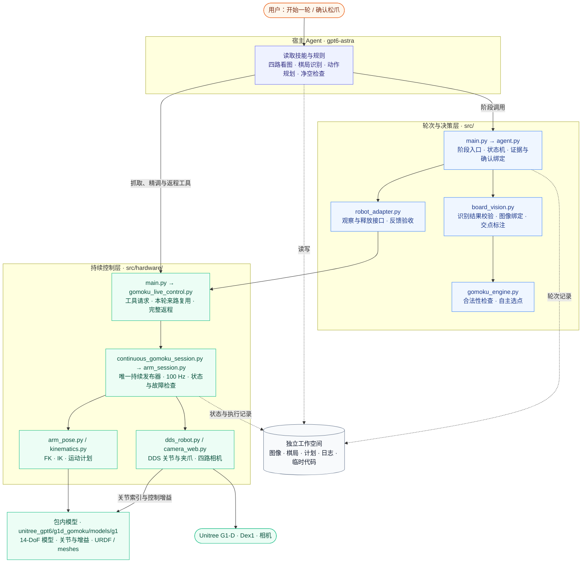
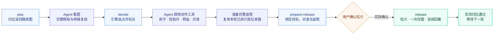
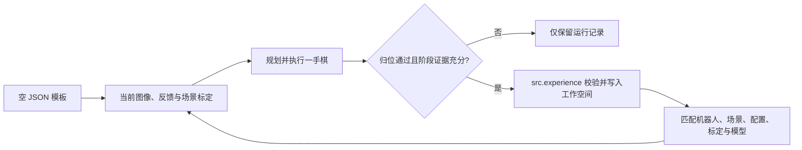

# G1-D 自主五子棋：代码框架与运行工作空间

[English](ARCHITECTURE.md) | 中文

这套技能由 **gpt6-astra 看图和规划、棋局引擎自主选点、持续控制进程驱动机器人**。用户发出“下一手”，Agent 自己完成观察、识别、抓子与对准，在松爪前等待用户确认，然后连续放子、回撤、归位。

Python CLI 是 Agent 的阶段工具，不会独立调用视觉大模型。只有自主下棋模式，没有人工指定落点入口。行列是引擎输出；像素、末端位姿和关节角是 Agent 与底层工具使用的内部数据。

## 1. 总体架构



图中实线是主要调用关系，虚线是文件读写；设备反馈沿控制接口返回。Agent 的思考与 100 Hz 发布循环分开运行，不能靠反复启动运动进程维持机器人姿态。

## 2. 各文件负责什么

| 文件 | 职责与边界 |
| --- | --- |
| [SKILL.zh.md](SKILL.zh.md) | Agent 的技能入口，定义一轮闭环及行为约束。 |
| [src/main.py](src/main.py) | `play / decide / prepare-release / release / status` 五个阶段入口。 |
| [src/agent.py](src/agent.py) | 保存轮次状态，绑定图像、选点、对准和返程；管理一次性释放确认，核验归位反馈。 |
| [src/board_vision.py](src/board_vision.py) | 校验 Agent 写入的完整棋局及图像摘要，投影网格并生成 SVG 标注；不执行视觉推理，也不提供像素到机器人的标定。 |
| [src/gomoku_engine.py](src/gomoku_engine.py) | 检查执黑回合与终局；先争取立即成五，再防白方直接成五，然后比较连续及跳空棋形。属于局部威胁策略。 |
| [src/robot_adapter.py](src/robot_adapter.py) | 对接已有发布器，检查归位后采图；释放时等完整回撤结束，保存工具日志。 |
| [src/hardware/main.py](src/hardware/main.py) | 硬件工具统一入口；`preflight` 只检查本地配置与依赖，不连接设备。 |
| [src/hardware/gomoku_live_control.py](src/hardware/gomoku_live_control.py) | 持续控制的请求接口、阶段记录、返程生成和释放授权检查。 |
| [src/hardware/continuous_gomoku_session.py](src/hardware/continuous_gomoku_session.py) | 扩展控制会话：固定臂位释放、保存一次图像，紧接着连续回撤。 |
| [src/hardware/arm_session.py](src/hardware/arm_session.py) | 唯一持续发布器、请求队列、控制锁、关节与反馈检查。 |
| [src/hardware/arm_pose.py](src/hardware/arm_pose.py)、[kinematics.py](src/hardware/kinematics.py) | FK/IK、位姿计划与到位检查；使用包内 G1 模型，不自动解决环境避障。 |
| [src/unitree_sdk2py/](src/unitree_sdk2py/VENDORED.md) | 技能内置 DDS SDK、IDL 消息、CRC 库和 BSD 3-Clause 许可；Python 引用使用技能命名空间。 |
| [src/hardware/dds_robot.py](src/hardware/dds_robot.py)、[camera_web.py](src/hardware/camera_web.py) | Unitree SDK2 / CycloneDDS 控制与状态、TeleImager 四路图像。 |
| [unitree_gpt6/g1d_gomoku/models/g1/](models/g1/) | G1 14-DoF 模型层、关节索引、控制增益、URDF 和网格资产；来源与许可证见其 `manifest.json` 和 `licenses/`。 |
| [src/hardware/common.py](src/hardware/common.py)、[reset_right.py](src/hardware/reset_right.py) | 私有配置与路径解析、现场归位参考及归位工具。 |
| [config/default.yaml](config/default.yaml) | 自主模式与棋规；不包含现场经验默认值。 |
| [config/hardware.example.yaml](config/hardware.example.yaml) | 通信与控制配置模板；网络字段由部署者填写，归位参考由当前设备只读采集。 |
| [src/experience.py](src/experience.py)、[experience/](experience/) | 空经验库与 JSON Schema、部署绑定、证据核对和成功后原子追加；只写工作空间。 |
| [tests/](tests/) | 用合成棋局、假相机和反馈验证逻辑，不等同于真机验收。 |

四路图像名为 `cam_left_high`、`cam_right_high`、`cam_left_wrist`、`cam_right_wrist`。棋局是 19×19 矩阵，0 为空、1 为黑、2 为白；行列从左头原图的上到下、左到右编号。机器人 TCP 使用 pelvis 坐标系，位置单位米、角度单位弧度，旋转采用 RzRyRx。

## 3. 一手棋如何流转



正常状态依次为 `observing → awaiting_board_review → target_selected → awaiting_release_confirmation → releasing_and_returning → returned`。抓取和精调期间仍处于 `target_selected`，具体运动进度记录在阶段文件里。

识别文件与本轮原图绑定；释放确认与本轮目标、对准及返程绑定。最终 XY 改变后重新准备连接段，不能继续沿用旧返程。返程在询问确认前完成，收到确认后不再临时思考路线；底层必要的状态和健康检查继续保留。

失败分别记录为 `observation_failed`、`execution_failed` 或 `return_unverified`，不能重放失败的释放请求。`returned` 只代表实测归位通过：放子后仅存图、不分析，故 `physical_placement_verified` 仍是 `false`。

字段格式和完整工具调用见 [自主执行流程](docs/autonomous_play.zh.md)；动作约束见 [操作规则](docs/operating_guide.zh.md)，定位、抓取与返程方法见 [操作方法](docs/manipulation.zh.md)，结构化经验的读写见 [经验数据](docs/experience.zh.md)。

## 4. gpt6-astra 的独立工作空间

使用环境变量 **`GOMOKU_WORKSPACE`** 指定运行工作空间，默认位于仓库根目录下的 `gomoku-workspace/`，也可以在初始化前自行设置该变量。该目录已加入 Git 忽略规则。从这里启动 gpt6-astra，运行文件只写入工作空间；源码、工程配置、文档和依赖声明保持只读。

工作空间从当前仓库模板初始化，不依赖开发者机器上的脚本、配置、标定或历史运行记录。

```text
gomoku-workspace/              # 默认位于仓库根目录下，由 GOMOKU_WORKSPACE 指定
├── config/hardware.local.yaml # 部署者的私有配置
├── calibration/               # 当前机器的归位参考与标定
├── experience/                # 成功后写入的经验与场景绑定，初始为空
├── scratch/                   # 临时 Python、计算、图像处理脚本
├── runtime/
│   ├── .arm_session.lock       # 运行时创建的唯一控制锁
│   ├── game/session/           # 发布器状态与请求队列
│   └── rounds/<唯一轮次>/      # 每一手独立保存，不能覆盖旧轮
├── logs/                      # 进程日志、后台参考查阅记录
├── cache/                     # 各工具缓存
├── tmp/                       # 临时文件
└── verification/              # 离线检查结果
```

本轮目录保存 `release_parameters.json`（本轮计算并核对的松爪开度）、`round.json`、`capture.json`、`board_capture/`、`board_observation.json`、`position_and_move.json` 和 `suggested_black_move.svg`；动作阶段保存计划及 before/after 证据；释放相关文件包括 `alignment_observation.json`、`return_plan.json`、`release_checkpoint.json`、一次性授权记录及 `release/return_result.json`。

### 环境与路径

先安装项目及所需硬件依赖，见 [硬件接入](docs/hardware_integration.zh.md)。下面在**仓库根目录**执行，只建立工作空间、复制硬件配置模板，不连接设备；不覆盖已有文件。

```bash
export GOMOKU_SOURCE_ROOT="$(pwd -P)"
export GOMOKU_WORKSPACE="${GOMOKU_WORKSPACE:-$GOMOKU_SOURCE_ROOT/gomoku-workspace}"
python -m unitree_gpt6.g1d_gomoku.src.workspace --workspace "$GOMOKU_WORKSPACE"
export GOMOKU_WORKSPACE="$(cd "$GOMOKU_WORKSPACE" && pwd -P)"
```

复制后填写相机地址和 DDS 网卡；归位参数从当前设备只读采集。runtime 路径为：

```yaml
runtime:
  directory: ../runtime
  reset_state: ../calibration/reset_right_state.json
```

**这些相对路径以 YAML 所在目录为基准，不以当前目录为基准。** 首次执行不使用现场经验默认值，先完成当前设备的归位参考和场景标定，见 [配置说明](config/README.zh.md)。成功后通过 `src.experience` 写入工作空间中的结构化经验；跨机器人、场景、配置、标定或模型的记录不匹配。

在启动宿主 Agent 或阶段工具前设置运行环境，`python` 使用部署者已配置好依赖的解释器：

```bash
export GOMOKU_HARDWARE_CONFIG="$GOMOKU_WORKSPACE/config/hardware.local.yaml"
export GOMOKU_OWNER_ROOT="$GOMOKU_WORKSPACE/runtime/game"
export PYTHONPATH="$GOMOKU_SOURCE_ROOT${PYTHONPATH:+:$PYTHONPATH}"
export PYTHONDONTWRITEBYTECODE=1
export TMPDIR="$GOMOKU_WORKSPACE/tmp"
export XDG_CACHE_HOME="$GOMOKU_WORKSPACE/cache"
export PIP_CACHE_DIR="$XDG_CACHE_HOME/pip"
export RUFF_CACHE_DIR="$XDG_CACHE_HOME/ruff"
export MPLCONFIGDIR="$XDG_CACHE_HOME/matplotlib"
mkdir -p "$PIP_CACHE_DIR" "$RUFF_CACHE_DIR" "$MPLCONFIGDIR"
cd "$GOMOKU_WORKSPACE"

# 只显示帮助，不连接机器人。
python -m unitree_gpt6.g1d_gomoku.src.main --help
```

每个独立工具进程都要继承这些环境变量，并以工作空间为当前目录。可将环境设置保存为自己工作空间内的脚本；开源项目不依赖任何预先存在的外部启动脚本。

后续工具统一传工作空间内的绝对路径：`--config "$GOMOKU_HARDWARE_CONFIG"`、`--owner-root "$GOMOKU_OWNER_ROOT"`、`--round "$GOMOKU_WORKSPACE/runtime/rounds/<唯一轮次>"`。低层发布器也使用同一配置和 owner 目录；同一台机器人不可通过另建 runtime 目录绕过已有控制锁。

### 运行期间的文件约定

- 临时脚本写入 `scratch/`；图像、计划及动作证据写入本轮目录；日志和参考查阅记录写入 `logs/` 或本轮目录。
- 运行文件只写入 `gomoku-workspace/` 或显式指定的独立工作空间，不执行修改源码、工程配置或文档的安装、格式化、自动修复或构建命令。需要修复工程时，另行进入用户授权的开发任务。
- 所有输出参数都显式指定工作空间内路径，避免工具默认写到工程。不要把工作空间输出目录做成指向工程的软链接。
- 以上是运行约定与路径配置，**不是操作系统级只读沙箱**；CLI 不会强制限制任意输出路径，Agent 必须遵守这些边界。

## 5. 经验数据生命周期



`experience/template.json` 和 `experience/schema.json` 随包发布，不包含经验值。
`src/experience.py` 不导入设备 SDK、不发运动命令，负责成功状态、数据结构、证据摘要、部署绑定和原子写入。
它不会从图像自动提取经验；宿主 Agent 在成功后生成候选数据，工具核对后提交。
经验用于后续候选求解，不能代替当前反馈或变成固定棋谱。
