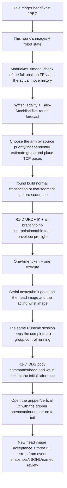

# R1-D Chess Operation Manual

English | [中文](operation_manual.zh.md)

> Main specification: complete commands, fields and exception handling. For task routing see [SKILL.md](../SKILL.md), for the per-round execution order see [round_plan](../prompts/round_plan.md), and for the mapping between scripts and modules see the [script inventory](round_script_inventory.md).
> In this document `bash r1d <subcommand>` is equivalent to `python scripts/<entry>.py`; the implementation is in `src/r1d_chess/`. Run artifacts (run directories, tokens, checkpoints, service logs) are all under `runs/` in the package root.
> Values marked "Reference" were measured on one reference robot. They only indicate the order of magnitude and must not be treated as measured values for a new robot or a new site.

This package lets an agent control a Unitree R1-D (R1-A7-D, Dex1 grippers) to play Chinese chess: normal moves and joint capture transactions, all-branch preflight, one-time tokens, serial visual gates, regrasp and correction, continuous return to init, and a two-item review. The lower layer uses the R1-D URDF (with Dex1) for FK/IK and gravity compensation, sends commands through the IPC of the robot runtime, and takes images from TeleImager.



## Entry points and runtime environment

Run `bash r1d <subcommand>` in the package root, or use `bash <absolute path of the package root>/r1d ...`, so that nothing depends on the cwd or shell variables of the previous tool call.

| Subcommand | Function |
|---|---|
| `serve` | Standalone chess REP service, read-only by default at startup; `--allow-motion` allows motion to be explicitly enabled later, which still requires complete geometry (measured calibration or model estimate are both accepted) and a single-owner handover |
| `client` | `ping/get_state/capture_cameras/set_active_arm/prepare_transaction/prepare_sequence/enable_control/release_control/execute_transaction/execute_sequence` and others |
| `round init/build/tokens` | Offline: create the run, build the complete branches, extract this round's execution request and the prepared file of each stage |
| `engine analyze/match/validate` | Legality of the actual position, search and a forecast of at most ten legal half-moves, matching of the actual reply |
| `candidates` | Full transaction preflight for the preferred arm and the other arm, in candidate order; does not execute |
| `serial next/submit` | Handles checkpoints through local files only; no robot connection and no automatic image-based approval |
| `gate` | Generates the evaluation for the stage and immediately submits the current checkpoint |
| `pose` | Generates grasp and place TCP poses from square names, or checks a filled-in spec |
| `board`, `boardview`, `fencheck`, `boardpoints`, `boardcal` | Board plane fitting, board-reading aid images, FEN check, 90-point measurement and board geometry re-measurement |
| `goinit`, `handover`, `start`, `retract` | Return to the reference pose, handover, one-command start, fault retract |
| `review` / `history` | Offline three event FK errors, accumulation per physical arm, merged named review |

Environment requirements:

- Python 3.10; dependency versions are in [requirements.txt](../requirements.txt). The R1-D SDK (`unitree_sdk2py`, public repository `unitreerobotics/unitree_sdk2_python`, verified commit `814556d15970`) is installed separately. The entry interpreter is taken, in order, from `R1D_CHESS_PYTHON`, `<package root>/.venv/bin/python`, and `python3` on PATH.
- The robot runtime (Runtime for short below) is bundled in `third_party/robot_runtime` (see the README in that directory) and is pointed to by `runtime_root` in `config/runtime.json`; the same file also holds the experiment, the DDS network interface and the camera host. Keep `camera_enabled` at `false`: the chess service fetches images itself, and the bundled Runtime contains no camera driver.
- Fairy-Stockfish must be built with `largeboards=yes` (a normal small-board build does not include xiangqi). Its path is given by `CHESS_ENGINE` or `--engine`; when neither is given, `fairy-stockfish` on PATH is used. Both it and pyffish must support `xiangqi`.

Example of rebuilding the environment (the robot does not need to be started):

```bash
uv venv --python 3.10 /path/to/venv
uv pip install --python /path/to/venv/bin/python -r requirements.txt
uv pip install --python /path/to/venv/bin/python --no-deps "unitree_sdk2py @ git+https://github.com/unitreerobotics/unitree_sdk2_python.git@814556d15970dd2ecf1c9984e845ca02ab07e206"
git clone https://github.com/fairy-stockfish/Fairy-Stockfish.git /path/to/engine
make -C /path/to/engine/src -j2 build ARCH=x86-64 largeboards=yes
```

After installation run `python scripts/check_environment.py` (offline). An installed environment does not mean moves can be made on the real robot right away; the site configuration below must also be completed.

## R1-D specific interfaces and coordinates

- Six groups of body commands: left arm 15–21, right arm 22–28, waist yaw 13, head pitch/yaw 29/30, left/right Dex1 31/33. The chassis and lift groups are not selected by default.
- The only DDS writer is `r1d-runtime.service` (the robot runtime, entry `bash r1d runtime serve`). The chess adapter only subscribes to the raw `rt/lowstate` / `rt/lowcmd` and submits complete six-group targets through the local Runtime IPC; it does not create a second LowCmd publisher.
- One session continuously holds the head pitch/yaw and waist yaw reference positions given by `head_q_rad` / `waist_q_rad`; both arms and the grippers are part of the same complete command. **After each move finishes and returns to init (or after `retract`), the service ends the session and unloads the arms**; the next round takes over again.
- FK/IK uses `robots/r1d_description/r1d.urdf` from unitree_ros (with Dex1, wrist pitch limit ±0.5236). The copy bundled in this package is [assets/models/r1d/r1d.urdf](../assets/models/r1d/r1d.urdf), specified by `model_urdf` in `config/runtime.json` (a relative path is resolved against the package root and can be overridden with `R1D_MODEL_URDF`). Do not use the `r1_a7.urdf` that ships with the Runtime to compute the TCP, init or the scene: it does not contain Dex1 and its wrist geometry is different.
- Coordinate frame: the FK root is `waist_yaw_link`, x forward, y left, z up, metres/radians. The TCP is the gripper flange (origin of `dex1_base_joint`).
- The Runtime uses its own PD gains. Every 20 ms the adapter sends the arm feedforward qtau together with the joint targets (gravity + friction + damping compensation + bounded integral). The parameters are in `config/arm_torque_ff.json` (`enabled=false` means qtau=0); see [r1d_joint_tracking_feedforward.md](r1d_joint_tracking_feedforward.md) for the description. When the session ends normally or on a fault, qtau is first ramped down to 0.
- IK: `Arm.solve` first uses analytic-Jacobian damped least squares and falls back to scipy `least_squares` only when that does not converge. Every target must satisfy model residuals of position <0.1 mm and orientation <0.001 rad as well as the URDF limits; this is a model residual, not the calibration accuracy of the physical robot. Do not switch back to scipy-first or change these tolerances, otherwise the complete preflight goes from tens of seconds to more than ten minutes.
- Cameras: the raw head stream (port 55555) is a 1280×480 side-by-side stereo image. The `cam_left_high` used for planning crops the 640×480 of the one eye given by `head_eye`, and the raw stereo image is kept; the wrist streams 55556/55557 correspond to `cam_left_wrist` / `cam_right_wrist`. Confirm the mapping between stream names and the physical left and right arms by looking at the images first, then write it into `config/chess_camera_policy.json`.
- The raw JPEG has no source timestamp; what is reported is the receive time, so strict synchronisation must not be claimed.

In the service protocol `right_arm` means the acting-arm role and `left_arm` means the non-acting-arm role; when the physical left arm acts, only the joints and roles are explicitly swapped, and XYZ is not mirrored. The state, prepared and checkpoint all state `active_arm`, the physical mapping and the camera selection.

## Site configuration (setup)

What ships in `config/` is the calibration result of one reference robot at its site; the same content is also stored in `config/reference/` for comparison. **Before starting to play chess in a new environment, you must first complete setup according to [setup/README.md](../setup/README.md) and update `config/` with the results of this robot.** For the meaning of each file and who reads it, see [config/README.md](../config/README.md).

| Item | Configuration | Method |
|---|---|---|
| Network interface, camera host, external hold program | `runtime.json` | Fill in for this robot; the network interface ships empty ([setup step 0](../setup/README.md)) |
| Mapping between camera streams and physical arms, which head eye to use | `chess_camera_policy.json`, `head_eye` in `robot.json` | [setup/camera-check](../setup/camera-check/README.md) |
| Initial chess pose (both arms, head, waist, lift) | `init_joint_rad`, `init_xyz_rpy`, `head_q_rad`, `waist_q_rad`, `lift_height_m` in `robot.json` | [setup/chess-scene-parameters](../setup/chess-scene-parameters/README.md) step 1 |
| Joint accuracy: dynamics of both arms, waist and head hold parameters | `arm_torque_ff.json`, `hold_joints.json`, the waist and head gains in `runtime.json`, the dynamics URDF | [setup/arm-calibration](../setup/arm-calibration/README.md), then verify on the Runtime path with [setup/joint-tracking](../setup/joint-tracking/README.md) |
| Head camera intrinsics and extrinsics | `head_camera_calibration.json` | [setup/head-camera-calibration](../setup/head-camera-calibration/README.md) |
| TCP, gripper envelope, scene, release height | `robot.json` | setup/chess-scene-parameters steps 2–7; for the meaning see [r1d_scene_parameters.md](r1d_scene_parameters.md) |
| Board position and the 90 intersections | `board_geometry.json` | setup/chess-scene-parameters steps 3–4; afterwards, when the board is moved, use `bash r1d boardcal`, see [board_position](../board_position/README.md) |

The wrist cameras get no intrinsic or extrinsic calibration: the wrist image is only judged by the agent looking at it at the gates, so the only thing to confirm is the mapping between streams and physical arms.

Check progress with `python scripts/setup_status.py`: each item shows "reference value, not set up", "updated (this robot)" or "confirmed to keep the reference value". **Before enabling motion for the first time, run `python scripts/setup_status.py --require`**; while any required item is still a reference value, do not make moves, unless the user has explicitly decided to keep it and has recorded the evidence with `--confirm`. After all setup is complete, first do one no-load path acceptance (after a complete preflight, execute one move without gripping a piece), then do real grasp and place.

Rules for `robot.json` (the profile):

- There are two geometry sources. Both can be used for planning, preflight and execution; completing a physical calibration first is not required:
  - Measured: `calibration_verified=true`, `calibration_evidence`, `camera_mapping_verified=true`;
  - Model estimate: both verified flags stay false, `geometry_source="model_estimate"`, and `estimate_evidence` records item by item the basis of the estimate for the TCP, init, scene, release height and camera mapping.
- Both sources must be numerically complete and pass validation; estimated values must not be marked as verified. When the TCP, init, scene or release height is missing, only read-only observation is possible.
- The profile must carry `kinematic_model_sha256`, equal to the hash of the current kinematic URDF; service startup and preflight reject a profile that lacks this field or does not match. Do not copy the hash by hand to make a profile obtained under another model pass the check; the geometry must be re-estimated for the current model.
- Content that must be supplemented and re-checked:
  1. The XYZ/RPY from the physical left and right wrists to the TCP, and the init TCP pose of each of the left and right arms.
  2. In the same coordinate frame, the board surface `surface_z`, the uncertainty, the complete gripper envelope and the clearance. `BoardGuard` is only a tool envelope and table check; **there is no collision detection for the whole arm, both arms, neighbouring pieces or the dynamic environment**, and neighbouring pieces must be re-checked against this round's two images.
  3. The base and board positions, the head and waist reference positions and the lift height `lift_height_m`. Taking over requires the height to be within ±5 mm, the head and waist to be close to the reference positions, and the chassis and lift to be stationary.
  4. The TCP heights for board release and tray release, `board_release_z_m` and `tray_release_z_m`.
  5. The physical left/right of the cameras and the head eye used; a real configuration keeps `simulation_only=false`.
- After the geometric conditions change: update the profile, restart the chess service while idle, observe again, and produce the plan and token again. The profile digest is bound to the observation and the plan, and the execution result archives the profile and URDF hashes.

`bash r1d board` fits the board plane from measured intersections. Input structure: `{"frame":"waist_yaw_link","spacing_m":[column spacing,row spacing],"evidence":"measurement record","points":[{"square":"a0","xyz_m":[...]} and so on, at least 4 non-collinear measured points]}`. The fit only gives board-surface intersections; it does not include the parallax of piece tops, finger offsets or piece occupancy.

Start the service read-only (for offline checks only; it does not take over or send motion):

```bash
bash r1d serve --arm right
bash r1d client get_state --save-response runs/MY_RUN/tmp/state.json
bash r1d client capture_cameras --cameras cam_left_high \
  --output-dir <package root>/runs/MY_RUN/images/initial \
  --save-response runs/MY_RUN/tmp/initial_observation.json
```

The service endpoint is `ipc:///tmp/astra_r1d_chess.sock`; flock guarantees that there is only one instance on the same endpoint. The launcher does not kill any other process.

## Starting a chess task: start the chess service first

**At the very beginning of every chess task, start the chess service and let it take over the robot. After that, all observation, planning, preflight and execution go through it; it is the only channel for communicating with the robot.** Do not start a separate hold service, and do not use other scripts to send commands directly to the robot: they compete with the service for the same Runtime session and do not go through preflight and tokens.

| Action | Command |
|---|---|
| Return to init | `client prepare_init`, then `client execute_init` |
| Normal move | `client prepare_transaction`, then `client execute_transaction` |
| Capture | `client prepare_sequence`, then `client execute_sequence` |
| Switch the acting arm | `client set_active_arm` (while execution is off) |
| Read state, capture images | `client get_state`, `client capture_cameras` |

### After a robot restart: return to the initial pose first (`goinit`)

After the robot restarts, the lift, head, waist, both arms and the grippers are usually not in the initial chess pose, and the takeover entry of the chess service refuses (lift difference >5 mm, head difference >0.35 rad, or grippers not closed). In that case run this separately **before taking over**:

```bash
bash r1d goinit              # read-only preview: current values, targets, differences, estimated duration; does not move the robot
bash r1d goinit --execute    # execute after a person confirms that the area around the robot and the arm motion range are safe
bash r1d goinit --status     # check progress (ready_for_chess=true in the log means in position)
```

- All targets are taken from `config/robot.json`: `lift_height_m`, `waist_q_rad`, `head_q_rad`, `init_joint_rad`, grippers closed.
- **No preflight of any kind** (no IK, collision, table clearance or path check); joint-space quintic polynomial interpolation, checking only joint limits; the arms have torque feedforward. Whether it is safe is judged by a person, and the agent must not run `--execute` on its own.
- Order: take over and hold in place for 1 s → lift to the target (at most 2 cm/s, arms held) → waist, head, both arms and grippers interpolate together (0.15 rad/s on average, at least 6 s) → hold continuously. The lift is adjusted first, to avoid lowering the body and pressing the hands onto the table when the hands are already above the table.
- When the tracking error exceeds 0.30 rad (arms) or 0.20 rad (head and waist), it freezes and holds in place; a person checks and then runs `--stop`.
- It runs in the background as the systemd user unit `r1d-chess-goinit` and keeps holding after reaching the pose; afterwards use `handover` to hand over to the chess service.
- `goinit --stop` only ends the hold (the arms lose the hold and sag) and is generally not used; use `handover` for a normal handover.
- `goinit` refuses to run when the chess service has already taken over; to return to init during play use `client prepare_init`/`execute_init`.

`bash r1d start --arm X --execute` chains "start the Runtime → start the service → goinit → handover → verify in position" into one command; it likewise requires a person to confirm safety first.

### Startup and takeover

1. Start the Runtime (this command has no effect when it is already running; it sends no commands to the robot before a control session is established). The user unit `r1d-runtime.service` is created by `python scripts/install_runtime_service.py --write`; it runs the Runtime from this package and reads `config/runtime.json`:
   ```bash
   systemctl --user start r1d-runtime.service
   systemctl --user is-active r1d-runtime.service   # should print active
   ```
2. Start the service in the background and keep it running:
   ```bash
   bash r1d serve --allow-motion --arm right    # the acting arm is chosen per round; it can be switched later with set_active_arm
   ```
3. Take over the robot:
   - A hold unit is running (`r1d-chess-goinit`, or the on-site hold service named by `hold_program` in `runtime.json`): `bash r1d handover --arm right --execute`, which first stops the hold and then takes over;
   - No hold service: `bash r1d client enable_control --arm right`.
   On takeover both arms hold their current position with torque feedforward, and the head and waist ramp from the measured position to the reference positions in `robot.json` at 0.2 rad/s.
4. `bash r1d client get_state` to confirm there is no fault, `head_waist_session_active=true`, and `head_q` has reached the reference position (then wait another 1 s for the image to stabilise).
5. **Turn the execution state off and keep the session**: `bash r1d client release_control`. After that `get_state` should show `control_enabled=false` and `head_waist_session_active=true`. **Only then capture the planning image**. `round build`, `set_active_arm` and `prepare_init` all require `control_enabled=false`.
6. After each round's complete preflight passes, use `client enable_control` to turn the execution state back on (the session already exists; this only turns on execution), then submit one execute. When execute ends, the execution state turns off automatically.
7. **After each move finishes and returns to init, the service automatically unloads the arms** (ends the session, both arms kp=kd=0, the result carries `arm_unload`; the arms are likewise unloaded after `retract`), to keep the motors from overheating under long-term load. So **every round must take over again starting from step 3**: when the head, waist, lift and grippers meet the entry conditions, run `client enable_control` directly, otherwise run `goinit` and then `handover` first; then steps 4–5. If an arm is more than 0.10 m from init after unloading, run `prepare_init`/`execute_init` first.

The service has two layers of state; do not confuse them: the **session** (`head_waist_session_active`) means the service has taken over and is holding the robot, while **execution** (`control_enabled`) only means that executing one move is allowed. Planning and preflight are done in the "session on, execution off" state. Taking over only holds the current posture and does not make a move; a move still requires this round's complete preflight, a one-time token and this round's execution authorisation.

Details of `handover`: without `--execute` it only performs checks. With `--execute` it first checks the geometry configuration, the service, the empty-and-closed gripper feedback, stillness, the height and the head and waist references, then stops the hold unit and enables the chess session. After a failed enable the original hold unit may already be stopped, so read the actual state; it does not restore AI or replay old arm positions. Gripper feedback close to closed cannot replace manual confirmation that the gripper is empty.

`enable_control` when there is no hold unit: the adapter first confirms that the Runtime is idle and in AI or released mode, releases AI and confirms that no LowCmd stream remains, and then establishes the session.

### Errors, returning to position and ending

**On an error or when asked to return to position**: `bash r1d retract`. It replays in reverse order the joint waypoints actually travelled by the last execute, returning to the starting point of that execution, without a new preflight. During the retract, as soon as the transport clearance height (`travel_clearance`) is reached, the acting arm's gripper is closed (the arm does not stop); when there is no point high enough on the path, the gripper is closed at the end point. While holding a piece, the close command does not change the grip. `retract` is only for faults or a user request and cannot replace gate approval; do not use `client set_gripper` to open the gripper manually to bypass the transaction. When the service has latched a fault, it first clears the fault and re-establishes the session. A motor fault, a feedback interruption or a tracking error above 0.20 rad still makes it stop.

**Ending the task**: press Ctrl-C in the service terminal, or `kill` the service process. The service first cancels motion and holds in place, then lowers the feedforward torque to 0 and ends the session, and then **unloads both arms** (kp, kd and tau all 0). The arms can be moved by hand and hang down naturally, so support them first or confirm that the space below is empty. The head, waist and grippers keep their last command. To avoid unloading, start with `serve --keep-arms-loaded`.

## Each round: observation, chess rules, estimation, complete preflight

1. `bash r1d round init --run <package root>/runs/<unique-round>`: creates tmp/images/docs and a spec with no values filled in.
2. From a new observation of the service, read the three-dimensional distance from each arm's TCP to its own init; if it is ≤0.10 m, start directly from the current pose. **Only the TCP distance counts; a joint configuration different from `init_joint_rad` is not a problem** (7-DOF redundancy; the path IK may stop at another solution). An arm beyond the limit is first returned with `prepare_init`/`execute_init`, and this round is then built from the new state. The non-acting arm keeps its position measured this round. The init target must not be treated as the measured starting point.
3. Capture only one planning image, `cam_left_high`, and check the complete position. Create a new `board.json` containing `game_id`, `confirmed:true`, `evidence:[path of this head image]`, `initial_fen` and the **actually confirmed** `moves:[UCI...]`. The FEN runs from the far rank9 to the near rank0; this board is a0→i9, corresponding to UCI rank numbers 1→10. Converting vision to FEN is done by the agent; this package has no automatic piece recognition.
   - When reading the board is difficult (especially Black's half at the far end), use `bash r1d boardview --observation <capture response json> --output <run>/images/board_view` to generate a top view, per-square enlarged images and an undistorted image. After writing the FEN, use `bash r1d fencheck "<FEN>" --view <same directory>` to draw it back onto the image and check square by square; the steps are in [board_view.md](../board_position/prompts/board_view.md).
   - **These images are only for reading the position and writing the FEN; they must not be used to estimate source/target poses.**
   - If the board has been moved, re-measure `config/board_geometry.json` first, otherwise the grid does not line up.
4. When there is a forecast for this game, first run `bash r1d engine match --board <this-round board.json> --forecast <previous-round move_forecast.json>`; reuse it only when the actual position and history match and a legal candidate remains. Only on a mismatch, exhaustion, or when neither arm can reach, run `engine analyze --board ... --output <new move_forecast.json>` again. The forecast contains only the at most ten half-moves actually returned by the engine and verified step by step against the chess rules; no opponent moves are invented.
5. Choose the arm by source: columns a–d prefer the left arm, columns e–i prefer the right arm, and crossing the whole board is allowed. `client set_active_arm --arm left/right` switches roles and clears the old cache only while execution is off; **after switching, capture a new observation and independently estimate the grasp and place poses for that arm**, and the other arm must not be dragged back by an old position command.
6. Fill in `round_spec.json`: the position file, the round and the Chinese move notation, the XYZ/RPY of source/target each with this round's evidence (**the pose is the TCP, see "spec grasp and place poses" below**), gate/travel/staging, and the board/neighbouring-piece/orientation re-check. `xy_error_context` uses the `r1d_<first 16 characters of the profile digest>` returned by the observation state, and an orientation-compatibility suffix may be appended. Before estimating, read the historical error of that physical arm with `history show`; it is for reference only and coordinates are not automatically adjusted by it.
7. `round build --run ... --spec ... --observation <complete observation response>`. It first checks whether the grip point of each pose falls within 12 mm of the intersection of the stated square (within 30 mm of the centre for the tray) and writes the result to `grip_points` in `plan_summary.json`; pyffish verifies the side to move, legality, target occupancy and the normal/capture type; then it generates the complete branches starting from this round's measured starting point. The source and target orientations each prefer lateral; when unreachable or interfering with a neighbouring piece, switch to longitudinal, and regenerate the poses, rebuild and preflight again.
8. Preflight: for a normal move `client prepare_transaction --arm <arm> --request tmp/request.json --save-response tmp/prepared.json`; for a capture use `prepare_sequence`, with one joint preflight for the two segments.
   - `prepare_*` and `execute_*` wait without a time limit by default. A complete preflight usually takes tens of seconds to two minutes. When it clearly exceeds a few minutes, look at the service log first and do not resend; an interrupted client or a timeout does not mean cancellation, and the result is determined by `cached_prepared` in the service log.
   - At the start of preflight the live joints are read: the waypoints of the non-acting arm in the plan are replaced by its live pose (hold only), and the first lift waypoint of the acting arm uses the live x/y/rpy. So an arm sagging a few millimetres after the image is captured does not require a new image.
   - The scene checks in preflight and execution only cover the acting arm; the non-acting arm is held by IK, but its contacts are not intercepted.
   - Only when the whole path of the preferred arm is unreachable, switch to the other arm and re-estimate, rebuild and preflight; only when neither arm can reach, switch to another chess-rule candidate.
9. `round tokens --run ... --prepared tmp/prepared.json` generates the one-time execute request and the prepared file of each stage. After modifying the plan, scene or starting point, switching arms, restarting the service, or once the token has been consumed, preflight again; an old token cannot be restored.

### Board geometry

`config/board_geometry.json` is the board fit measured by the head camera; the grid of `boardview` should line up with the printed lines. **When the landing point is inaccurate, do not change the geometry**: at the low gate before release, check independently with the wrist image and submit an XY `adjust` (see the gate rules below).

> Reference: a landing-point deviation usually arises in the grip or the lowering process, not in the board geometry. On the reference robot the geometry was once shifted as a whole to compensate for a landing-point deviation; as a result the grasp depth became wrong, and the change was later reverted.

### spec grasp and place poses: TCP and grip point

The `xy_m` and `z_m` of `source`, `target`, `capture.source` and `capture.offboard_target` in `round_spec.json` are all the **TCP**, that is, the Dex1 flange (origin of `dex1_base_joint`), **not the piece position**. The fingers extend along the +x of the TCP, and the grip point is 137 mm from the flange (the fingertip is at 143.2 mm, and the grip centre is about 6 mm inside the fingertip, that is, the front part of the gripper):

```text
d      = (cos(pitch)·cos(yaw), cos(pitch)·sin(yaw), −sin(pitch))
grip point = TCP + 0.137·d          TCP = grip point − 0.137·d
```

**Grasp and place orientation: pitch 0.8 rad (about 46°), grasping and placing with the front part of the gripper.** The wrist is raised and the downward tilt is large, which reduces accidental contact with neighbouring pieces. With the fingers pointing towards −y, the TCP is 95.4 mm in the +y direction from the intersection and 98.3 mm above it. Height rules:

- Grasp: the fingertip is 3 mm above the board surface (TCP z = surface_z + 0.003 + 0.1432·sin p).
- Release: **the board-release TCP z of all moves is fixed at 0.150 m, independent of pitch** (`grip_pose.BOARD_RELEASE_TCP_Z_M`; at pitch 0.8 the fingertip is about 35 mm above the board surface). For the tray, it is converted from the fingertip height of the profile's `tray_release_z_m`. The profile's `board_release_z_m` corresponds to pitch 0.35; changing the pitch does not change the profile, and `round build` validates according to the pitch.
- `gate_z_m` must give the pre-grasp high position transport clearance (tool clearance ≥40 mm): at pitch 0.8 use **0.175**; 0.16 is rejected by preflight.
- **Placing a captured piece into the tray**: turning while holding a piece is only reachable at the transport height directly above the tray, so when the target orientation differs from the source, the plan is "translate to above the target keeping the source orientation → turn in place → descend"; after the first capture segment puts the piece down, the arm turns back in place above the tray and then hands over to the second segment. When the tray is fairly full, the release gate must avoid the tray rim and the pieces already placed; when necessary, do an XY adjust according to the wrist image.
- **Opening the gripper for release**: when the neighbouring points on both sides of the target along the opening direction are empty, the opening is 3.0 (about 47 mm); otherwise use `gripper_open_q` (2.3) so as not to push a neighbouring piece; tray release uses 3.0. `round build` decides automatically, and the result is in `release_open` in `plan_summary.json`. After the gripper has opened, hold in place for 0.5 s and then lift.

> Reference: on the reference robot, the left arm can reach the left tray only with finger yaw −0.8 (pointing diagonally to the front right) (`pose --role tray --tray left --yaw=-0.8`); at the low position the arm is actually about 1 cm higher than commanded, and the pre-grasp low gate often shows most of the piece outside the fingertips, which is handled with `adjust_pitch`. The reachable orientations and the low-position deviation of a new robot must be confirmed on that robot.

Generate with the tool; do not calculate by hand:

```bash
bash r1d pose pose --role source --square c5 --fingers=-y            # grasp (default pitch 0.8, 137 mm)
bash r1d pose pose --role target --square d7 --fingers=-y            # place
bash r1d pose pose --role tray --tray left --fingers=-y               # put a captured piece into the tray on the same side
bash r1d pose pose --role source --square c5 --offset-xy 0.002 -0.003 # the image estimate shows the piece offset from the intersection
bash r1d pose check --spec /this-round-run/round_spec.json                  # check a filled-in spec
```

Fill the output `xy_m/z_m/rpy_rad` directly into the spec, and replace `<evidence from this round's planning image>` in `evidence` with this round's image evidence; `_grip_point_xyz_m` is for checking only. `round build` rejects a spec whose grip point is not on the stated square (for example, one that puts the TCP directly on the intersection). For the basis of the parameters see [r1d_scene_parameters.md](r1d_scene_parameters.md).

Optional batch preflight: `candidates --candidates candidates.json --output selected.json`. The input is an array ranked by the chess rules, each item containing `move/source_square/requests:{left:<path of the complete left-arm request>,right:<path of the complete right-arm request>}`. Both requests must already have been built independently from this round's pose of their respective physical arm. The first successful prepared is written to the same directory as the corresponding request and is **not executed**.

### Return to init

`client prepare_init --arm <arm> --request init_request.json`; the request contains only `{"archive_dir":"/this-round-run/tmp/init"}`. It computes the distance from each arm to its own init from the current feedback; an arm at ≤0.10 m holds in place, and a fully preflighted "vertical rise → high translation/reorientation → vertical descent" path is generated only for an arm beyond the limit. When neither arm needs to return, it returns `init_required=false` and produces no token; when needed, after taking over, execute once with `client execute_init --arm <arm> --request <JSON containing this token>`, verify the result, then observe again and build the move plan. Initialisation likewise requires an empty gripper, complete geometry and motion authorisation.

The last pose of every move (including failure fallback and the second capture segment) and of `prepare_init` is the joint pose of init (`init_joint_rad`). The return process: translate from staging to the travel height above init, turning on the way to the roll/yaw of init and pitch 0.4 rad; then, at the travel height, keep the TCP still while the joint configuration switch completes, descend vertically to init so that the joints finally equal `init_joint_rad` exactly, and after that close the gripper.

## Enabling and execution (only when explicitly authorised for this round)

After each round's preflight passes: first run `get_state` to confirm that `state_age_s` is normal, wait about 3 s, then run `client enable_control --arm <arm>` (enabling immediately after preflight ends may trigger a stale-lowstate fault). Check `control_enabled=true` and no fault, then immediately submit **once**:

```bash
bash r1d client execute_transaction --request /this-round-run/tmp/execute_request.json \
  --timeout 900000 --save-response /this-round-run/tmp/result.json
```

For a capture, replace the command with `execute_sequence`; the two sub-transactions must not be sent separately. Keep this long call running, and in another terminal only read the local checkpoints and submit:

```bash
bash r1d serial next --prepared /this-round-run/tmp/stage_1_prepared.json --seconds 45
bash r1d gate --prepared /this-round-run/tmp/stage_1_prepared.json --checkpoint /returned-checkpoint.json \
  --decision success|adjust|adjust_pitch|retry_high|failure --reason "evidence from the two images" [--offset dx dy]
```

`gate` automatically generates the evaluation for the stage (the evidence is the two images of that checkpoint) and immediately runs `serial submit`; you can also write the evaluation file yourself and use `serial submit --evaluation`. The templates are in `assets/templates/` (six fields for source, seven fields for target). `adjust` must be given `--offset` (metres, base frame, relative to the measured FK of the checkpoint).

Gate rules:

- **Gates are judged and immediately submitted by the executing agent**; do not ask the user gate by gate. Each time, look only at the head image and the wrist image of the physical acting arm specified by the current checkpoint.
- **No gate has a time limit**: the checkpoint has `wait_indefinitely=true` and no deadline, and the service holds the current position until it receives a decision. No time limit does not mean it is fine to be slow: the target for each gate is about 5 s. After `next` returns `needs_review`, do only "look at the two images → submit → immediately `next`"; in between, do not read code, change code, check logs, send `get_state`/`capture`, or run tests. A REQ timeout does not mean cancellation.
- **No adjustment during execution is preflighted**: the high-position XY correction, the low-position pitch reduction, the `retry_high` rise, the release XY correction and the release tail after approval are all sent directly after only solving IK. A motor fault, a 0.20 rad tracking error, a feedback timeout or a Runtime error still stops the motion.
- **Source high gate**: if the piece is midway between the two jaws, `success`; otherwise `adjust`, at most three times, with a new image each time.
- **Pre-close gate (low)**: XY correction is not allowed.
  - The piece centre is already past the jaw tips and roughly between the two jaws: `success` and close the gripper; do not go back to the high position because of a lateral offset of a few millimetres.
  - Most of the piece is beyond the tips of the two fingers and the front ends of the two fingers do not enclose the piece: `adjust_pitch`, which reduces the downward tilt by 0.1 rad with the TCP position, yaw and roll unchanged, followed by a new image, at most twice (`max_low_pitch_adjustments`).
  - Clearly offset so far that the piece would be pushed away by a single jaw: `retry_high`, which returns vertically to the high position with the gripper open.
  - `adjust_z` is off by default (`max_low_z_adjustments=0`).
  - When the service determines an empty grasp after closing the gripper, it automatically rises back to the high position, takes a new image and grasps again; the gripper is really closed at most three times.
- **Pre-release gate**: after a successful grasp, the piece is carried continuously to the target high position and lowered, and a new image is taken before the gripper opens.
  - **The landing point must be checked independently with the wrist image, not from FK alone**: FK and the board geometry come from the same source, so when the geometry is off, FK does not show it. Along the finger direction (the depth direction of the wrist image), find a known neighbouring piece or printed intersection, use the piece diameter as a local scale, measure the distance from the centre of the gripped piece to it, and compare it with the expected distance; laterally, look at the grid lines on both sides in the same way. Take the piece diameter, column spacing and row spacing from the measured values of this board.
  - If the deviation in either direction is >5 mm, submit `adjust`, fill `actual_relative_offset_xy_m` with that deviation (base frame, metres), and do a low-position XY correction keeping the actual Z/RPY. At most three times, with a new image after each of the first two.
  - No new image is taken after the last correction, so when submitting it you must confirm from the two existing images that the **expected landing point after the correction** can be released safely, set `release_alignment_verified=true` in the evaluation and state the basis in reason. Both the client and the server reject a last adjustment without this confirmation. Having used up the attempts is not in itself a basis for release.
  - When it cannot be confirmed, there is a collision risk, or the user terminates, submit `failure`: stop and keep holding the piece, with no automatic release or retract.
- **Termination before grasp**: when the user asks to terminate or it is impossible to continue, a pre-grasp checkpoint can use `serial submit ... --failure`, which needs no evaluation file and backs out along the cached failure path. Ordinary insufficient centring does not count as termination.
- **Automatic wrap-up after release**: after `success` is submitted at pre_release, the service continuously completes "open the gripper in place → hold 0.5 s → lift vertically to clearance with the gripper open → retreat to staging with the gripper open → close the gripper in place → return to init at the high position", with no gate in between and no further command needed (before the gripper opens there is a fixed 1 s settle and a few seconds of local IK compilation). After the gripper opens in the first capture segment, the second segment follows continuously, without returning to init, without enabling again and without sending another execute.
- **Unloading**: the arms are automatically unloaded only after the results that have returned to init, `placed`/`completed`/`*_returned*`; results stopped midway such as `stopped_after_fault` are not unloaded (the arm would hit the board), and the session is kept. You can also run `bash r1d client unload_arms` manually. `arm_tau_max_abs_after_nm` in the result is the estimated torque of the motors of both arms about 1 s after unloading; within about 0.1 Nm means the motors no longer produce torque. At init the hands are very close to the table; after unloading the arms rest on the table and on joint friction, and it is normal that they appear almost motionless.

> Reference: the dimensions of the reference robot and board are piece diameter 29.7 mm, adjacent columns 35.6 mm, adjacent rows 34.2 mm, with a gap of about 6 mm between the edges of adjacent pieces. When release was approved on FK alone, landing-point deviations of about 2 cm occurred.

Passing field validation does not mean the service can verify neighbouring pieces and the landing point from the images; these judgements are always the agent's responsibility.

## Review after completion and service lifecycle

The review consists of only two items:

1. Capture a new `cam_left_high` and judge whether the source has been vacated, whether the piece has landed on the target, the offset and the uncertainty; write this round's `tmp/visual_review.json`, containing at least `move_success`, the image path and time, and a description of the offset.
2. On the real transaction result run `review --result ... --output docs/pose_review.json`, which computes, for the two events grasp success and low pre-release, the three errors relative to the original plan, the final target and the FK commanded at that time. For a capture, compute the two sub-transactions separately; the sequence wrapper must not be treated as a transaction result. Then:

```bash
bash r1d history finish --run /this-round-run --game-id <game-id> --round-number <our-round-number-in-this-game> \
  --move-plan <chinese-move> --context-id <this-r1d_context> \
  --report /this-round-run/docs/pose_review.json --visual-review /this-round-run/tmp/visual_review.json \
  --plan-summary /this-round-run/tmp/plan_summary.json
```

For a capture, put the main move report first, then repeat `--report` to give the removal report. The output is `docs/第N轮_中文着法_北京时间.json` (round N, Chinese move notation, Beijing time) and `execution_xy_errors.jsonl` in the same directory, which accumulates "actual FK minus final target" separately per physical arm and per source/target; failed, missing, off-board removal and over 25 mm samples are kept as evidence only and are not learned from; the same token is idempotent. The historical mean does not automatically modify coordinates.

Service lifecycle:

- After each round completes normally, the service automatically ends the session and unloads both arms; results stopped midway or with a fault keep the session.
- `release_control` only stops transaction execution and holds the last position. `release_waist`, after execution is off, ends the whole six-group session (head, both arms, grippers); it **does not restore AI, does not cut power and is not a hardware emergency stop**. `shutdown` requires the session to have been released. Run these commands only when explicitly requested and after verifying that a handover is possible; the review does not include shutting down the service.
- The following conditions latch a fault and end the current session, with no automatic recovery and no automatic retract: DDS feedback not updated for more than 0.15 s, an IPC timeout, a Runtime fault or thermal protection, a motor fault, over-temperature, or an arm tracking error above `arm_tracking_limit_rad` (0.20 rad). The head and waist deviation, the lift height and chassis stillness are checked only at the takeover entry and are not checked again during the session. This does not guarantee mechanical braking; act according to the actual feedback and the on-site state. A latched fault is cleared only by restarting the service while there is no motion.
- SIGINT/SIGTERM, while a session still exists, only request cancellation and hold; the REP channel must not be treated as an independent emergency stop.

## Initial chess pose

`init_joint_rad`, `init_xyz_rpy`, `head_q_rad`, `waist_q_rad` and `lift_height_m` in `config/robot.json` define the initial pose; `goinit`, `prepare_init`, the return to init and the "≤0.10 m from init" test all use it. `config/chess_initial_pose.json` is the original record of this set of values; the code does not read it.

- How to record it: put the robot into the chess posture (both arms resting on the two sides of the board, grippers closed, fingertips leaving clearance above the table), read the joint angles from `rt/lowstate` and write them into `init_joint_rad`, then compute `init_xyz_rpy` from the current kinematic URDF and the flange TCP.
- `init_joint_rad` is a joint record; `prepare_init` plans with `init_xyz_rpy` in TCP space and does not replay the joint snapshot directly.
- The head is locked at a pitch close to its lowest position (reference value 0.62 rad, limit 0.628). This puts the board at the centre of the image with less distortion. The planning image, the board geometry and the board-reading tools all assume this viewpoint; after changing the head reference position, re-measure the board geometry.
- On takeover the head may be at most 0.35 rad from the reference position, and the service turns the head there at 0.2 rad/s; the waist must be within ±0.1 rad. These are the conditions of the takeover entry.
- The head yaw has backlash (reference value about ±15 mrad); return to the reference position from the same direction every time.
- On takeover the lift height must be within ±5 mm of the reference value, and the chassis and lift must be stationary; they are not checked again during the session, and the program does no closed-loop hold of the lift either, so do not move the chassis or the lift during play.

> Reference: the init of the reference robot is left TCP≈(0.194, 0.356, 0.010) m, right≈(0.177, −0.379, 0.023) m, head 0.62/−0.0036 rad, waist 0.029 rad, lift 0.439 m.

## Verification and capability limits

```bash
python -B -m unittest discover -s tests -v
```

The tests use the R1-D URDF in the package and a simulated transport, and do not connect to DDS or real cameras. They cover reachable and unreachable cases for both arms, left/right roles and cameras, complete preflight of normal moves and captures, token replay protection, serial gate execution, `retry_high`, release XY correction, failure retract, event FK, idempotent log merging, Runtime command mapping and rejection of stale feedback.

Capability limits:

- When the geometry is a model estimate, planning and execution are possible, but this does not mean the path has been accepted or that grasp and place are accurate. On a new robot, first do the no-load path acceptance, then the real grasp-and-place and on-square placement acceptance.
- There is no automatic piece recognition, no automatic hand-eye calibration and no full-model collision detection.
- Simulation results, the `placed` status or a small FK error must not be treated as a successful placement on the square on the real robot; the head image after the move is authoritative.

Places that are given for the reference robot and may need adjustment on a new robot:

- `src/r1d_chess/chess/round_tools.py`: the yaw of the right arm on the way back to init is fixed at 0 (the init yaw of the reference robot is unreachable during the return). When the init posture of a new robot is different, the return path may fail preflight and must be adjusted accordingly.
- `RANGE` in `setup/arm-calibration/r1_d/tools/hold_calib.py`: the waist sweep range comes from the mechanical limits of the reference robot; before calibrating, check the actual rotation range of this robot's waist.
- `setup/arm-calibration/r1_d/sdk/model.py`: the upper limit of the right wrist pitch and the motor numbers targeted by `--ignore-link-loss`.
- The offline tests are written for the reference configuration; after `config/` is updated, cases that depend on specific values may fail.
