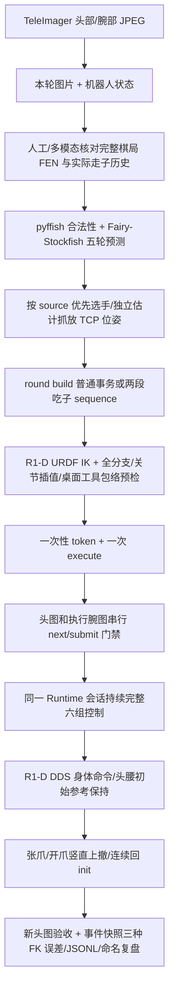

# R1-D 象棋操作手册

[English](operation_manual.md) | 中文

> 主规范：完整命令、字段和异常处理。任务路由见 [SKILL.zh.md](../SKILL.zh.md)，每轮执行顺序见 [round_plan](../prompts/round_plan.zh.md)，脚本与模块对应关系见 [脚本清单](round_script_inventory.zh.md)。
> 文中的 `bash r1d <子命令>` 等价于 `python scripts/<入口>.py`，实现位于 `src/r1d_chess/`。运行产物（run 目录、token、检查点、服务日志）都在包根的 `runs/` 下。
> 标为“参考”的数值来自一台参考机器人的实测，只说明量级，不能当作新机器人或新场地的实测值。

本包让 agent 控制 Unitree R1-D（R1-A7-D，Dex1 夹爪）下中国象棋：普通走子和吃子联合事务、全分支预检、一次性 token、串行视觉门禁、重抓及修正、连续回 init、两项复盘。底层用 R1-D URDF（含 Dex1）做 FK/IK 与重力补偿，经机器人运行时的 IPC 下发，图像来自 TeleImager。



## 入口和运行环境

在包根运行 `bash r1d <子命令>`，或用 `bash <包根绝对路径>/r1d ...`，避免依赖前一次工具调用的 cwd 或 shell 变量。

| 子命令 | 功能 |
|---|---|
| `serve` | 独立象棋 REP 服务，启动默认只读；`--allow-motion` 允许以后显式启用，仍需完整几何（实测标定或模型估计均可）和唯一所有者交接 |
| `client` | `ping/get_state/capture_cameras/set_active_arm/prepare_transaction/prepare_sequence/enable_control/release_control/execute_transaction/execute_sequence` 等 |
| `round init/build/tokens` | 离线建 run、完整分支、提取本轮执行请求和各 stage prepared |
| `engine analyze/match/validate` | 实际棋局合法性、搜索及最多十个合法半回合预测、实际应手匹配 |
| `candidates` | 按候选顺序对首选手和另一手做完整事务预检；不执行 |
| `serial next/submit` | 仅通过本地文件处理检查点；没有机器人连接或自动看图放行 |
| `gate` | 按阶段生成评价并立即提交当前检查点 |
| `pose` | 由格名生成抓放 TCP 位姿，或核对已填 spec |
| `board`、`boardview`、`fencheck`、`boardpoints`、`boardcal` | 棋盘平面拟合、读棋辅助图、FEN 核对、90 点实测和棋盘几何重测 |
| `goinit`、`handover`、`start`、`retract` | 回参考位、交接、一键启动、故障回撤 |
| `review` / `history` | 离线事件 FK 三种误差、按物理手累计、合并命名复盘 |

环境要求：

- Python 3.10，依赖版本见 [requirements.txt](../requirements.txt)；R1-D SDK（`unitree_sdk2py`，公开仓库 `unitreerobotics/unitree_sdk2_python`，已验证的提交 `814556d15970`）另行安装。入口解释器依次取 `R1D_CHESS_PYTHON`、`<包根>/.venv/bin/python`、PATH 上的 `python3`。
- 机器人运行时（下文简称 Runtime）内置在 `third_party/robot_runtime`（见该目录的 README），由 `config/runtime.json` 的 `runtime_root` 指向；同一文件里还有 experiment、DDS 网卡和相机主机。`camera_enabled` 保持 `false`：象棋服务自己取图，内置 Runtime 不含相机驱动。
- Fairy-Stockfish 必须用 `largeboards=yes` 构建（普通小棋盘构建不包含象棋），路径由 `CHESS_ENGINE` 或 `--engine` 指定，都不给时用 PATH 上的 `fairy-stockfish`；它和 pyffish 都要支持 `xiangqi`。

重建环境的示例（无需启动机器人）：

```bash
uv venv --python 3.10 /path/to/venv
uv pip install --python /path/to/venv/bin/python -r requirements.txt
uv pip install --python /path/to/venv/bin/python --no-deps "unitree_sdk2py @ git+https://github.com/unitreerobotics/unitree_sdk2_python.git@814556d15970dd2ecf1c9984e845ca02ab07e206"
git clone https://github.com/fairy-stockfish/Fairy-Stockfish.git /path/to/engine
make -C /path/to/engine/src -j2 build ARCH=x86-64 largeboards=yes
```

装好后运行 `python scripts/check_environment.py`（离线）。环境装好不等于可以直接实机走棋，还要完成下面的现场配置。

## R1-D 专属接口及坐标

- 六组身体命令：左臂 15–21、右臂 22–28、腰 yaw 13、头 pitch/yaw 29/30、左/右 Dex1 31/33。默认不选择底盘和升降组。
- 唯一的 DDS 写入者是 `r1d-runtime.service`（机器人运行时，入口 `bash r1d runtime serve`）。象棋适配只订阅原始 `rt/lowstate` / `rt/lowcmd`，经本机 Runtime IPC 提交完整六组目标，不创建第二个 LowCmd publisher。
- 一条会话持续保持 `head_q_rad` / `waist_q_rad` 指定的头 pitch/yaw 与腰 yaw 参考位；双臂和夹爪是同一完整命令的一部分。**每步走完回到 init（或 `retract` 后）服务会结束会话并卸力**，下一轮重新接管。
- FK/IK 使用 unitree_ros 的 `robots/r1d_description/r1d.urdf`（含 Dex1，腕 pitch 限位 ±0.5236），本包内置副本 [assets/models/r1d/r1d.urdf](../assets/models/r1d/r1d.urdf)，由 `config/runtime.json` 的 `model_urdf` 指定（相对路径按包根解析，可用 `R1D_MODEL_URDF` 覆盖）。不要用 Runtime 自带的 `r1_a7.urdf` 计算 TCP、init 或场景：它不含 Dex1，腕部几何不同。
- 坐标系：FK 根为 `waist_yaw_link`，x 前、y 左、z 上，米/弧度。TCP 取夹爪法兰（`dex1_base_joint` 原点）。
- Runtime 使用自带 PD 增益。适配每 20 ms 随关节目标下发臂部前馈 qtau（重力 + 摩擦 + 阻尼补偿 + 有界积分），参数在 `config/arm_torque_ff.json`（`enabled=false` 即 qtau=0），说明见 [r1d_joint_tracking_feedforward.zh.md](r1d_joint_tracking_feedforward.zh.md)。会话正常结束或故障时先把 qtau 斜坡降为 0。
- IK：`Arm.solve` 先用解析雅可比阻尼最小二乘，不收敛才退回 scipy `least_squares`。每个目标必须满足位置 <0.1 mm、姿态 <0.001 rad 的模型残差及 URDF 限位；这是模型残差，不是实体标定精度。不要换回 scipy 优先或改这些容差，否则完整预检会从几十秒变成十分钟以上。
- 相机：头部原始流（端口 55555）是 1280×480 左右双目拼接，规划用的 `cam_left_high` 裁取 `head_eye` 指定的一眼 640×480，并保留原始双目图；腕流 55556/55557 对应 `cam_left_wrist` / `cam_right_wrist`。流名与物理左右手的对应要先看图确认，再写进 `config/chess_camera_policy.json`。
- 原始 JPEG 没有源时间戳，报告的是接收时刻，不能声称严格同步。

服务协议中的 `right_arm` 表示执行臂角色、`left_arm` 表示非执行臂角色；物理左手执行时只显式交换关节和角色，不镜像 XYZ。状态、prepared 和 checkpoint 同时标明 `active_arm`、物理映射与相机选择。

## 现场配置（setup）

`config/` 里随包附带的是一台参考机器人在其场地上的标定结果，同样的内容另存在 `config/reference/` 供对照。**在新环境开始下棋之前，必须先按 [setup/README.zh.md](../setup/README.zh.md) 完成 setup，用本机的结果更新 `config/`。** 各文件的含义和读取者见 [config/README.zh.md](../config/README.zh.md)。

| 项目 | 配置 | 方法 |
|---|---|---|
| 网卡、相机主机、外部保持程序 | `runtime.json` | 按本机填写，网卡随包为空（[setup 第 0 步](../setup/README.zh.md)） |
| 相机流与物理手的对应、头部用哪只眼 | `chess_camera_policy.json`、`robot.json` 的 `head_eye` | [setup/camera-check](../setup/camera-check/README.zh.md) |
| 下棋初始位姿（双臂、头、腰、升降） | `robot.json` 的 `init_joint_rad`、`init_xyz_rpy`、`head_q_rad`、`waist_q_rad`、`lift_height_m` | [setup/chess-scene-parameters](../setup/chess-scene-parameters/README.zh.md) 第 1 步 |
| 关节精度：双臂动力学、腰头保持参数 | `arm_torque_ff.json`、`hold_joints.json`、`runtime.json` 的腰头增益、动力学 URDF | [setup/arm-calibration](../setup/arm-calibration/README.zh.md)，再用 [setup/joint-tracking](../setup/joint-tracking/README.zh.md) 在 Runtime 链路上验证 |
| 头部相机内外参 | `head_camera_calibration.json` | [setup/head-camera-calibration](../setup/head-camera-calibration/README.zh.md) |
| TCP、夹爪包络、场景、释放高度 | `robot.json` | setup/chess-scene-parameters 第 2–7 步，含义见 [r1d_scene_parameters.zh.md](r1d_scene_parameters.zh.md) |
| 棋盘位置和 90 个交叉点 | `board_geometry.json` | setup/chess-scene-parameters 第 3–4 步；之后棋盘移动时用 `bash r1d boardcal`，见 [board_position](../board_position/README.zh.md) |

腕部相机不做内外参标定：腕图只由 agent 在门禁时看图判断，需要确认的只是流与物理手的对应。

进度用 `python scripts/setup_status.py` 查看：每一项显示“参考值，未 setup”“已更新（本机）”或“已确认沿用参考值”。**第一次打开运动之前先运行 `python scripts/setup_status.py --require`**；有必做项仍是参考值时不走子，除非用户明确决定沿用并用 `--confirm` 记录了依据。完成全部 setup 后，先做一次空载路径验收（完整预检后不夹棋子执行一步），再做真实抓放。

`robot.json`（profile）的规则：

- 几何来源有两种，都可以规划、预检和执行，不要求先完成实物标定：
  - 实测：`calibration_verified=true`、`calibration_evidence`、`camera_mapping_verified=true`；
  - 模型估计：两个 verified 标志保持 false，`geometry_source="model_estimate"`，`estimate_evidence` 逐项记录 TCP、init、scene、释放高度与相机映射的估计依据。
- 两种来源都必须数值完整并通过校验；估计值不得标成 verified。缺 TCP、init、scene 或释放高度时只能只读观测。
- 必须带 `kinematic_model_sha256`，且等于当前运动学 URDF 的哈希；服务启动和预检会拒绝缺少该字段或不一致的 profile。不要手抄哈希让别的模型下得到的 profile 过检，几何必须按当前模型重新估计。
- 需要补充并复核的内容：
  1. 物理左右腕到 TCP 的 XYZ/RPY，左右臂各自的 init TCP 位姿。
  2. 同一坐标系的板面 `surface_z`、不确定度、完整夹爪包络和净空。`BoardGuard` 只是工具包络和桌面检查，**没有全机械臂、双臂、邻子和动态环境碰撞检测**，邻子要按本轮两图复核。
  3. 基座和棋盘位置、头腰参考位及升降高度 `lift_height_m`。接管要求高度在 ±5 mm 内、头腰接近参考位且底盘和升降静止。
  4. 棋盘释放和圆盘释放的 TCP 高度 `board_release_z_m`、`tray_release_z_m`。
  5. 相机物理左右和所用的头部眼；真实配置保留 `simulation_only=false`。
- 几何条件改变后：更新 profile，在空闲状态重启象棋服务，重新观测、重新出计划和 token。profile 摘要会绑定观测和计划，执行结果会归档 profile 和 URDF 哈希。

`bash r1d board` 从实测交点拟合棋盘平面，输入结构：`{"frame":"waist_yaw_link","spacing_m":[列距,行距],"evidence":"测量记录","points":[{"square":"a0","xyz_m":[...]} 等至少 4 个非共线实测点]}`。拟合只给板面交点，不含棋子顶面视差、手指偏置或棋子占用。

只读启动服务（只用于离线检查，不会接管或发运动）：

```bash
bash r1d serve --arm right
bash r1d client get_state --save-response runs/MY_RUN/tmp/state.json
bash r1d client capture_cameras --cameras cam_left_high \
  --output-dir <包根>/runs/MY_RUN/images/initial \
  --save-response runs/MY_RUN/tmp/initial_observation.json
```

服务端点是 `ipc:///tmp/astra_r1d_chess.sock`，同一端点用 flock 保证只有一个实例；启动器不杀任何其他进程。

## 开始下棋任务：先启动象棋服务

**每个下棋任务一开始就启动象棋服务，并让它接管机器人。之后所有观测、规划、预检和执行都通过它进行，它是与机器人通信的唯一通道。** 不要另起保持服务，也不要用其他脚本直接给机器人发命令：它们会和服务争夺同一个 Runtime 会话，也不经过预检和 token。

| 动作 | 命令 |
|---|---|
| 回到 init | `client prepare_init`，再 `client execute_init` |
| 普通走子 | `client prepare_transaction`，再 `client execute_transaction` |
| 吃子 | `client prepare_sequence`，再 `client execute_sequence` |
| 切换执行手 | `client set_active_arm`（执行关闭时） |
| 读取状态、拍图 | `client get_state`、`client capture_cameras` |

### 机器人重启后：先回初始位姿（`goinit`）

机器人重启后升降、头、腰、双臂、夹爪通常都不在下棋初始位姿，象棋服务的接管入口会拒绝（升降差 >5 mm、头差 >0.35 rad 或夹爪未闭合）。此时在**接管之前**单独运行：

```bash
bash r1d goinit              # 只读预览：当前值、目标、差值、预计时长，不动机器人
bash r1d goinit --execute    # 人确认机器人周围和手臂运动范围安全后执行
bash r1d goinit --status     # 查看进度（日志里 ready_for_chess=true 即到位）
```

- 目标全部取自 `config/robot.json`：`lift_height_m`、`waist_q_rad`、`head_q_rad`、`init_joint_rad`，夹爪闭合。
- **不做任何预检**（无 IK、碰撞、桌面净空、路径检查），关节空间五次多项式插值，只检查关节限位；手臂带力矩前馈。是否安全由人判断，agent 不得自行执行 `--execute`。
- 顺序：接管并原地保持 1 s → 升降到目标（最快 2 cm/s，手臂保持）→ 腰、头、双臂、夹爪一起插值（平均 0.15 rad/s，至少 6 s）→ 持续保持。先调升降，避免手已在桌面上方时降低机身把手压向桌面。
- 跟随误差超过 0.30 rad（手臂）或 0.20 rad（头腰）时原地冻结保持，由人检查后 `--stop`。
- 它作为 systemd 用户单元 `r1d-chess-goinit` 后台运行，到位后一直保持；随后用 `handover` 交给象棋服务。
- `goinit --stop` 只结束保持（手臂失去保持、会下垂），一般不用；正常交接用 `handover`。
- 象棋服务已经接管时 `goinit` 会拒绝运行；下棋过程中回 init 用 `client prepare_init`/`execute_init`。

`bash r1d start --arm X --execute` 把“启动 Runtime → 启动服务 → goinit → handover → 核对到位”串成一条命令，同样需要人先确认安全。

### 启动和接管

1. 启动 Runtime（已在运行时这条命令没有影响；控制会话建立前它不给机器人发命令）。`r1d-runtime.service` 这个用户单元由 `python scripts/install_runtime_service.py --write` 创建，它从本包运行 Runtime 并读取 `config/runtime.json`：
   ```bash
   systemctl --user start r1d-runtime.service
   systemctl --user is-active r1d-runtime.service   # 应输出 active
   ```
2. 在后台启动服务并保持它一直运行：
   ```bash
   bash r1d serve --allow-motion --arm right    # 执行手按本轮选择，之后可用 set_active_arm 切换
   ```
3. 接管机器人：
   - 有保持单元在运行（`r1d-chess-goinit`，或 `runtime.json` 的 `hold_program` 指明的现场保持服务）：`bash r1d handover --arm right --execute`，先停保持，再接管；
   - 没有保持服务：`bash r1d client enable_control --arm right`。
   接管时双臂保持当前位置并带力矩前馈，头腰从实测位置以 0.2 rad/s 斜坡转到 `robot.json` 的参考位。
4. `bash r1d client get_state` 确认无 fault、`head_waist_session_active=true`、`head_q` 到达参考位（之后再等 1 s 让画面稳定）。
5. **关闭执行状态、保留会话**：`bash r1d client release_control`。之后 `get_state` 应显示 `control_enabled=false` 且 `head_waist_session_active=true`。**然后再拍规划图**。`round build`、`set_active_arm`、`prepare_init` 都要求 `control_enabled=false`。
6. 每轮完整预检通过后，用 `client enable_control` 重新打开执行状态（会话已存在，只是打开执行），然后提交一次 execute。execute 结束时执行状态自动关闭。
7. **每步走完回到 init 后服务自动卸力**（结束会话、两臂 kp=kd=0，结果里带 `arm_unload`；`retract` 后同样卸力），避免电机长时间出力过热。所以**每一轮都要从第 3 步重新接管**：头腰、升降和夹爪满足入口条件时直接 `client enable_control`，否则先 `goinit` 再 `handover`；然后第 4–5 步。卸力后手臂若离 init 超过 0.10 m，先 `prepare_init`/`execute_init`。

服务里有两层状态，不要混淆：**会话**（`head_waist_session_active`）表示服务已接管并保持机器人，**执行**（`control_enabled`）只表示允许执行一次走子。规划和预检在“会话开、执行关”的状态下进行。接管只是保持当前姿态，不会走子；走子仍要求本轮完整预检、一次性 token 和本轮执行授权。

`handover` 的细节：不带 `--execute` 时只做检查。带 `--execute` 时先检查几何配置、服务、空闭合反馈、静止、高度和头腰参考，再停止保持单元并启用象棋会话。启用失败后原保持单元可能已停止，要读实际状态；它不会恢复 AI 或重放旧手臂位置。夹爪反馈接近闭合不能代替人工确认空爪。

没有保持单元时的 `enable_control`：适配先确认 Runtime 空闲且处于 AI 或已释放模式，释放 AI 后确认没有残留 LowCmd 流，再建立会话。

### 出错、回位和结束

**出错或要求回位时**：`bash r1d retract`。它把上一次 execute 实际走过的关节路点倒序重放，回到这次执行的起点，不做新的预检。回撤中一到达运输净空高度（`travel_clearance`）就闭合执行手夹爪（手臂不停）；路径上没有足够高的点时在终点闭爪。持棋时闭爪命令不改变夹持。`retract` 只用于故障或用户要求，不能代替门禁审批；不要用 `client set_gripper` 手动张爪绕过事务。服务锁存了故障时，它会先清除故障并重新建立会话。电机故障、反馈中断、跟随误差超过 0.20 rad 仍会让它停下。

**结束任务**：在服务终端按 Ctrl-C，或 `kill` 服务进程。服务先取消运动并原地保持，再把前馈力矩降到 0、结束会话，然后**给两臂卸力**（kp、kd、tau 全为 0），手臂可以拖动、会自然垂下，所以要先扶住或确认下方空。头、腰和夹爪保持最后的命令。不想卸力时用 `serve --keep-arms-loaded` 启动。

## 每轮：观测、棋规、估计、完整预检

1. `bash r1d round init --run <包根>/runs/唯一轮次`：创建 tmp/images/docs 和未填数值的 spec。
2. 从服务新观测读取双臂 TCP 到各自 init 的三维距离，≤0.10 m 就直接从当前位姿开始。**只看 TCP 距离，关节构型与 `init_joint_rad` 不同不算问题**（7 自由度冗余，路径 IK 可能停在另一组解）。超限的手臂先用 `prepare_init`/`execute_init` 归位，再以新状态建本轮。非执行臂保持本轮实测位置。不能把 init 目标当实测起点。
3. 只采 `cam_left_high` 一张规划图，核对完整棋局。新建 `board.json`，包含 `game_id`、`confirmed:true`、`evidence:[本次头图路径]`、`initial_fen` 和**实际已确认**的 `moves:[UCI...]`。FEN 为远端 rank9 到近端 rank0；本盘 a0→i9，对应 UCI 的行号 1→10。视觉转 FEN 由 agent 完成，本包没有自动识棋。
   - 读棋困难时（尤其远端黑方半场）用 `bash r1d boardview --observation <capture 响应 json> --output <run>/images/board_view` 生成俯视图、逐格放大图和去畸变图，写好 FEN 后用 `bash r1d fencheck "<FEN>" --view <同一目录>` 画回图上逐格核对，步骤见 [board_view.zh.md](../board_position/prompts/board_view.zh.md)。
   - **这些图只用于读棋局、写 FEN，不能用来估计 source/target 位姿。**
   - 棋盘移动过时先重测 `config/board_geometry.json`，否则网格会对不上。
4. 有本局预测时先 `bash r1d engine match --board 本次board.json --forecast 上轮move_forecast.json`；实际棋局和历史匹配且仍有合法候选才复用。失配、耗尽或双方都不可达时才重新 `engine analyze --board ... --output 新move_forecast.json`。预测只含引擎真实返回且逐步棋规验证的最多十个半回合，不补造对手着法。
5. 按 source 选手：a–d 列优先左手，e–i 列优先右手，允许跨整盘。`client set_active_arm --arm left/right` 只在执行关闭时切换角色并清空旧缓存；**切换后重新采观测、独立估计该手抓放位姿**，另一只手不得被旧位置命令拖回。
6. 填 `round_spec.json`：棋局文件、轮次和中文着法、source/target 各自 XYZ/RPY 及本轮依据（**位姿是 TCP，见下面“spec 抓放位姿”**）、gate/travel/staging、棋盘/邻子/姿态复核。`xy_error_context` 采用观测 state 返回的 `r1d_<profile摘要前16位>`，可附加姿态兼容后缀。估计前用 `history show` 读取该物理手的历史误差，只作参考，不自动加减坐标。
7. `round build --run ... --spec ... --observation 完整观测响应`。它先核对每个位姿的夹持点是否落在所写格子交叉点 12 mm 内（托盘为中心 30 mm 内），结果写入 `plan_summary.json` 的 `grip_points`；pyffish 验证行棋方、合法性、目标占用和普通/吃子类型；然后生成从本轮实测起点出发的完整分支。source/target 姿态分别优先横向，不可达或邻子干涉时改纵向，并重新生成位姿、重建和预检。
8. 预检：普通走子 `client prepare_transaction --arm 所选手 --request tmp/request.json --save-response tmp/prepared.json`；吃子用 `prepare_sequence`，两段一次联合预检。
   - `prepare_*`、`execute_*` 默认不限时等待。完整预检通常几十秒到两分钟，明显超过几分钟时先看服务日志，不要重发；客户端被打断或超时都不等于取消，结果以服务日志 `cached_prepared` 为准。
   - 预检开始时读实时关节：计划里非执行手的航点替换为它的实时位姿（只保持），执行手第一个抬升航点改用实时 x/y/rpy。所以拍图后手臂下沉几毫米不需要重拍。
   - 预检和执行中的场景检查只针对执行手；非执行手由 IK 保持，但它的碰触不会被拦截。
   - 首选手整条不可达才换另一手重估、重建、预检，两手都不可达才换棋规候选。
9. `round tokens --run ... --prepared tmp/prepared.json` 生成一次性 execute 请求和各 stage prepared。修改计划、scene 或起点，切手，重启服务，或 token 已消费后，都要重新预检，旧 token 不能恢复。

### 棋盘几何

`config/board_geometry.json` 是头部相机测得的棋盘拟合结果，`boardview` 的网格应与印刷线对齐。**落点不准时不要改几何**：在释放前的低位门禁用腕图独立核对并提交 XY `adjust`（见下文门禁规则）。

> 参考：落点偏差通常出在夹持或下落过程，而不是棋盘几何。参考机器人上曾用整体平移几何来补偿落点偏差，结果抓取深度随之出错，后来撤销。

### spec 抓放位姿：TCP 与夹持点

`round_spec.json` 的 `source`、`target`、`capture.source`、`capture.offboard_target` 的 `xy_m`、`z_m` 都是 **TCP**，即 Dex1 法兰（`dex1_base_joint` 原点），**不是棋子位置**。手指沿 TCP 的 +x 伸出，夹持点离法兰 137 mm（指尖 143.2 mm，夹持中心在指尖内约 6 mm，即夹爪前部）：

```text
d      = (cos(pitch)·cos(yaw), cos(pitch)·sin(yaw), −sin(pitch))
夹持点 = TCP + 0.137·d          TCP = 夹持点 − 0.137·d
```

**抓放姿态：pitch 0.8 rad（约 46°），用夹爪前部抓放。** 手腕抬高、向下倾角较大，可以减少误触邻子。手指朝 −y 时 TCP 在交叉点 +y 方向 95.4 mm、上方 98.3 mm。高度规则：

- 抓取：指尖在板面上方 3 mm（TCP z = surface_z + 0.003 + 0.1432·sin p）。
- 释放：**所有走棋的棋盘释放 TCP z 固定为 0.150 m，与 pitch 无关**（`grip_pose.BOARD_RELEASE_TCP_Z_M`；pitch 0.8 时指尖在板面上方约 35 mm）。托盘用 profile `tray_release_z_m` 的指尖高度换算。profile 的 `board_release_z_m` 对应 pitch 0.35，换 pitch 不改 profile，`round build` 按 pitch 校验。
- `gate_z_m` 必须让抓前高位有运输净空（工具净空 ≥40 mm）：pitch 0.8 时用 **0.175**，0.16 会被预检拒绝。
- **吃子放入圆盘**：持子转向只在圆盘正上方的运输高度可达，所以目标姿态与源不同时，计划是“保持源姿态平移到目标上方 → 原地转向 → 下降”，吃子第一段放下后在圆盘上方原地转回再交接第二段。圆盘较满时释放门禁要避开盘沿和已放棋子，必要时按腕图做 XY adjust。
- **释放张爪**：张爪方向上目标两侧邻点都空时开度 3.0（约 47 mm），否则用 `gripper_open_q`（2.3）以免推到邻子；托盘释放用 3.0。`round build` 自动判断，结果在 `plan_summary.json` 的 `release_open`。张爪到位后原位保持 0.5 s 再上撤。

> 参考：参考机器人上，左手只有手指 yaw −0.8（斜向右前）能到达左盘（`pose --role tray --tray left --yaw=-0.8`）；低位手臂实际比命令高约 1 cm，抓前低位门禁常看到棋子大半在指尖外，这种情况用 `adjust_pitch` 处理。新机器人的可达朝向和低位偏差要自己确认。

用工具生成，不要手算：

```bash
bash r1d pose pose --role source --square c5 --fingers=-y            # 抓取（默认 pitch 0.8、137 mm）
bash r1d pose pose --role target --square d7 --fingers=-y            # 落子
bash r1d pose pose --role tray --tray left --fingers=-y               # 吃子放入同侧托盘
bash r1d pose pose --role source --square c5 --offset-xy 0.002 -0.003 # 图像估计棋子偏离交叉点
bash r1d pose check --spec /本轮run/round_spec.json                  # 核对已填 spec
```

输出的 `xy_m/z_m/rpy_rad` 直接填入 spec，`evidence` 里的 `<本轮规划图依据>` 换成本轮图像依据；`_grip_point_xyz_m` 只供核对。`round build` 拒绝夹持点不在所写格子上的 spec（例如把 TCP 直接放在交叉点上）。参数依据见 [r1d_scene_parameters.zh.md](r1d_scene_parameters.zh.md)。

可选的批量预检：`candidates --candidates candidates.json --output selected.json`。输入是按棋规排名的数组，每项含 `move/source_square/requests:{left:左手完整request路径,right:右手完整request路径}`。两个请求都必须已按各自物理手的本轮位姿独立构建。首个成功的 prepared 写在对应 request 同目录，**不执行**。

### 回 init

`client prepare_init --arm 所选手 --request init_request.json`，请求只含 `{"archive_dir":"/本轮run/tmp/init"}`。它按当前反馈计算每只手到各自 init 的距离，≤0.10 m 的手臂原地保持，只为超限的手臂生成“竖直上升 → 高位平移/转姿 → 竖直下降”的完整预检路径。两臂都不需要归位时返回 `init_required=false`，不产生 token；需要时在接管后用 `client execute_init --arm 所选手 --request 含本次token的JSON` 执行一次，核实结果后重新观测并构建走棋计划。初始化同样要求空爪、完整几何和运动授权。

每步走完（含失败回退和吃子第二段）以及 `prepare_init` 的最后一个位姿都是 init 的关节位姿（`init_joint_rad`）。回位过程：从 staging 平移到 init 上方的 travel 高度，途中转到 init 的 roll/yaw、pitch 0.4 rad；然后在 travel 高度保持 TCP 不动完成关节构型切换，再竖直降到 init，最后关节严格等于 `init_joint_rad`，之后闭爪。

## 启用与执行（仅当本轮明确授权）

每轮预检通过后：先 `get_state` 确认 `state_age_s` 正常，等约 3 s，再 `client enable_control --arm 所选手`（预检刚结束就立刻 enable 可能触发 lowstate 过期故障）。核对 `control_enabled=true`、无 fault，然后立即提交**一次**：

```bash
bash r1d client execute_transaction --request /本轮run/tmp/execute_request.json \
  --timeout 900000 --save-response /本轮run/tmp/result.json
```

吃子把命令换成 `execute_sequence`，不能分开发两个子事务。保留这个长调用，另一个终端只读本地检查点并提交：

```bash
bash r1d serial next --prepared /本轮run/tmp/stage_1_prepared.json --seconds 45
bash r1d gate --prepared /本轮run/tmp/stage_1_prepared.json --checkpoint /本次返回的checkpoint.json \
  --decision success|adjust|adjust_pitch|retry_high|failure --reason "两图依据" [--offset dx dy]
```

`gate` 按阶段自动生成评价（证据为该检查点两图）并立即 `serial submit`；也可以自己写评价文件后用 `serial submit --evaluation`，模板在 `assets/templates/`（source 六字段、target 七字段）。`adjust` 必须给 `--offset`（米，基座系，相对检查点实测 FK）。

门禁规则：

- **门禁由执行的 agent 判断并立即提交**，不逐个询问用户。每次只看当前 checkpoint 指定的头图和物理执行手腕图。
- **所有门禁都不限时**：checkpoint 是 `wait_indefinitely=true`、没有 deadline，服务在当前位置保持到收到决定为止。不限时不等于可以慢：每个门禁目标约 5 s，`next` 返回 `needs_review` 后只做“看两图 → 提交 → 立刻 `next`”，中间不读代码、不改代码、不查日志、不发 `get_state`/`capture`、不跑测试。REQ 超时不等于取消。
- **执行中的所有调整都不预检**：高位 XY 修正、低位减倾角、`retry_high` 上升、释放 XY 修正和批准后的释放尾段都只解 IK 后直接下发。电机故障、0.20 rad 跟随误差、反馈超时、Runtime 错误仍会停下。
- **source 高位**：棋子在两爪中间则 `success`；否则 `adjust`，最多三次，每次复拍。
- **闭爪前（低位）**：不允许 XY 修正。
  - 棋子中心已过爪尖、大致在两爪之间：`success` 闭爪，不因横向偏几毫米而回高位。
  - 棋子大部分在两指尖端外、两指前端没有包住棋子：`adjust_pitch`，按 0.1 rad 减小向下倾角，TCP 位置、yaw、roll 不变，之后复拍，最多两次（`max_low_pitch_adjustments`）。
  - 明显偏到会被单爪顶开：`retry_high`，开爪竖直回高位。
  - `adjust_z` 默认关闭（`max_low_z_adjustments=0`）。
  - 闭爪后服务判定空抓时自动升回高位、复拍并重新抓取；真实闭爪最多三次。
- **释放前**：抓成功后连续搬运到 target 高位并下降，张爪前复拍。
  - **必须用腕图独立核对落点，不能只看 FK**：FK 与棋盘几何同源，几何偏了 FK 看不出来。沿手指方向（腕图纵深方向）找一个已知邻子或印刷交点，用棋子直径作局部比例尺，量被夹棋子中心到它的距离，与应有距离比较；横向同理看两侧格线。棋子直径、列距、行距取本棋盘的实测值。
  - 任一方向偏差 >5 mm 就提交 `adjust`，`actual_relative_offset_xy_m` 填该偏差（基座系，米），保持实际 Z/RPY 做低位 XY 修正。最多三次，前两次后复拍。
  - 最后一次修正不再复拍，所以提交它时必须以现有两图确认**修正后的预计落点**可安全释放，评价里 `release_alignment_verified=true` 并在 reason 写明依据。客户端和服务端都拒绝未获此确认的最后一次调整。次数用完本身不是释放依据。
  - 无法确认、有碰撞风险或用户终止时提交 `failure`：停止并保持持棋，不自动松手或回撤。
- **抓前终止**：用户要求终止或无法继续时，抓前检查点可 `serial submit ... --failure`，不需要评价文件，按缓存失败路径退回。普通对中不足不算终止。
- **释放后自动收尾**：pre_release 提交 `success` 后，服务连续完成“原位张爪 → 保持 0.5 s → 开爪竖直上撤至净空 → 开爪退 staging → 原位闭爪 → 高位回 init”，中间没有门禁，不需要再发命令（张爪前有固定 1 s 静置和几秒的局部 IK 编译）。吃子第一段张爪后连续衔接第二段，不回 init、不再次 enable、不多发 execute。
- **卸力**：只在 `placed`/`completed`/`*_returned*` 这些回到 init 的结果之后自动卸力；`stopped_after_fault` 等停在半路的结果不卸力（手臂会砸到棋盘），会话保持。也可手动 `bash r1d client unload_arms`。结果里的 `arm_tau_max_abs_after_nm` 是卸力约 1 s 后两臂电机的估计力矩，约 0.1 Nm 以内即电机不再出力。init 处手离桌面很近，卸力后手臂靠在桌面和关节摩擦上，看起来几乎不动是正常的。

> 参考：参考机器人和棋盘的尺寸为棋子直径 29.7 mm、相邻列 35.6 mm、相邻行 34.2 mm，相邻棋子边缘间隙约 6 mm。只按 FK 放行时出现过约 2 cm 的落点偏差。

字段校验通过不等于服务能从图像验证邻子和落点，这些判断始终是 agent 的责任。

## 完成后的复盘与服务生命周期

复盘只做两项：

1. 新采一张 `cam_left_high`，判断 source 是否腾空、棋子是否落在 target、偏位及不确定性；写本轮 `tmp/visual_review.json`，至少含 `move_success`、图片路径和时间、偏位说明。
2. 对真实事务结果执行 `review --result ... --output docs/pose_review.json`，计算抓成和低位释放前两个事件相对原计划、最终目标、当时命令 FK 的三种误差。吃子分别计算两个子事务，不能把 sequence 包装层当事务结果。随后：

```bash
bash r1d history finish --run /本轮run --game-id 本局ID --round-number 本局我方轮次 \
  --move-plan 中文着法 --context-id 本次r1d_context \
  --report /本轮run/docs/pose_review.json --visual-review /本轮run/tmp/visual_review.json \
  --plan-summary /本轮run/tmp/plan_summary.json
```

吃子时主走棋报告放第一个，再重复 `--report` 指定移除报告。输出 `docs/第N轮_中文着法_北京时间.json` 和同目录 `execution_xy_errors.jsonl`，按物理手和 source/target 分开累计“实际 FK 减最终目标”；失败、缺失、棋外移除和超过 25 mm 的样本只留证据不学习；同一 token 幂等。历史均值不会自动修改坐标。

服务生命周期：

- 每轮正常完成后服务自动结束会话并给两臂卸力；停在半路或有故障的结果保持会话。
- `release_control` 只停止事务执行并保持最后位置。`release_waist` 在执行关闭后结束整个六组会话（头、双臂、夹爪），**不恢复 AI、不断电、不是硬件急停**。`shutdown` 要求会话已释放。这些命令只在明确要求并核实可交接时执行；复盘不包含关闭服务。
- 下列情况会锁存故障并结束本次会话，不自动恢复，也不自动回撤：DDS 反馈超过 0.15 s 不更新、IPC 超时、Runtime 故障或热保护、电机故障、过温、手臂跟踪误差超过 `arm_tracking_limit_rad`（0.20 rad）。头腰偏差、升降高度和底盘静止只在接管入口检查，会话中不再检查。这不保证机械制动，要按实际反馈和现场状态处理。锁存的故障只在没有运动时通过重启服务清除。
- SIGINT/SIGTERM 在仍有会话时只请求取消和保持；REP 通道不能当作独立急停。

## 下棋初始位姿

`config/robot.json` 的 `init_joint_rad`、`init_xyz_rpy`、`head_q_rad`、`waist_q_rad`、`lift_height_m` 定义初始位姿；`goinit`、`prepare_init`、回 init 和“距 init ≤0.10 m”的判断都用它。`config/chess_initial_pose.json` 是这组数值的原始记录，代码不读。

- 记录方法：把机器人摆到下棋姿态（双臂停在棋盘两侧、夹爪闭合、指尖离桌面留出净空），读 `rt/lowstate` 的关节角写入 `init_joint_rad`，再按当前运动学 URDF 和法兰 TCP 算出 `init_xyz_rpy`。
- `init_joint_rad` 是关节记录；`prepare_init` 用 TCP 空间的 `init_xyz_rpy` 规划，不直接回放关节快照。
- 头部锁定在接近最低头的 pitch（参考值 0.62 rad，限位 0.628）。这样棋盘位于画面中心、畸变更小。规划图、棋盘几何和读棋工具都以这个视角为准，改头部参考位后要重测棋盘几何。
- 接管时头可以离参考位最多 0.35 rad，服务以 0.2 rad/s 把头转过去；腰要求在 ±0.1 rad 内。这是接管入口的条件。
- 头 yaw 有回差（参考值约 ±15 mrad），每次从同一方向回到参考位。
- 升降高度在接管时要在参考值 ±5 mm 内，且底盘和升降静止；会话中不再检查，程序也不对升降做闭环保持，所以下棋过程中不要移动底盘或升降。

> 参考：参考机器人的 init 为左 TCP≈(0.194, 0.356, 0.010) m、右≈(0.177, −0.379, 0.023) m，头 0.62/−0.0036 rad、腰 0.029 rad、升降 0.439 m。

## 验证与能力边界

```bash
python -B -m unittest discover -s tests -v
```

测试使用包内 R1-D URDF 和模拟 transport，不连接 DDS 或真相机；覆盖双臂可达与不可达、左右角色与相机、普通和吃子完整预检、token 防重放、串行门禁执行、`retry_high`、释放 XY 修正、failure 回撤、事件 FK、日志合并幂等、Runtime 命令映射和过期反馈拒绝。

能力边界：

- 几何是模型估计时可以规划和执行，但不代表路径已验收或抓放准确。新机器人要先做空载路径验收，再做真实抓放和落格验收。
- 没有自动识棋、自动手眼标定和全模型碰撞检测。
- 仿真结果、`placed` 状态或小 FK 误差都不能当作实机落格成功，以走后头图为准。

按参考机器人给出、新机器人上可能需要调整的地方：

- `src/r1d_chess/chess/round_tools.py`：右手回 init 途中的 yaw 固定为 0（参考机器人的 init yaw 在回程中不可达）。新机器人的 init 姿态不同时，回位路径可能预检失败，需要相应调整。
- `setup/arm-calibration/r1_d/tools/hold_calib.py` 的 `RANGE`：腰的扫描范围来自参考机器人的机械限位，标定前先核对本机腰的实际可转范围。
- `setup/arm-calibration/r1_d/sdk/model.py`：右腕 pitch 的上限和 `--ignore-link-loss` 针对的电机编号。
- 离线测试按参考配置编写，更新 `config/` 后依赖具体数值的用例可能失败。
